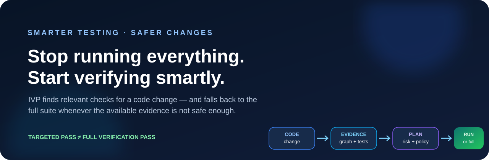
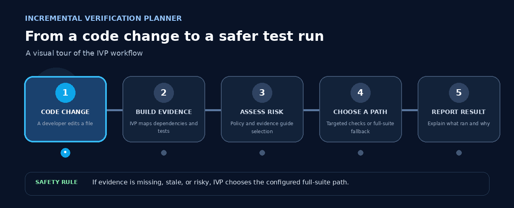
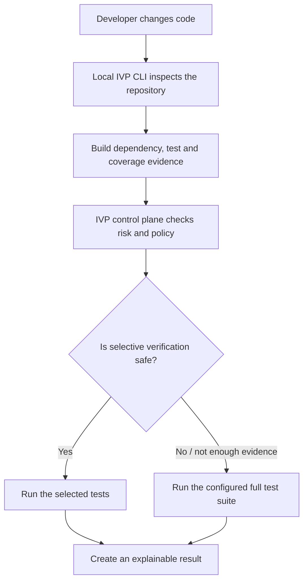

<div align="center">
  

  <h1>Incremental Verification Planner (IVP)</h1>
  <p><strong>Spend less time waiting for tests. Keep the checks that protect your code.</strong></p>

  <p>
    <a href="https://github.com/Debarshi-Gupta/incremental-verification-planner">
      
    </a>
    
    
    
    <a href="https://github.com/Debarshi-Gupta/incremental-verification-planner/blob/main/LICENSE">
      
    </a>
  </p>

  <p>
    <em>For developers, CI pipelines, and AI coding agents.</em>
  </p>
</div>

---

## 🚦 The problem

You change one small function. Your project has hundreds—or thousands—of tests. Do you really need to run every single test again?

Running everything after every change can mean:

- ⏳ Developers wait longer for feedback.
- 💸 CI machines spend time running tests that may be unrelated to the change.
- 🔁 Pull requests take longer to validate.

But simply skipping tests is risky. A test that *looks* unrelated might be the one that catches a bug.

## 💡 The idea behind IVP

**IVP (Incremental Verification Planner) figures out which tests are relevant to a code change and recommends what should run.**

It looks at repository dependencies, test and coverage evidence, execution history, and verification policy. When that evidence is missing, old, incomplete, or risky, IVP takes the safer route: **run the configured full test suite.**

> A targeted test pass is not the same as a full verification pass. IVP keeps that distinction clear.

## 🎬 See the workflow

<p align="center">
  
</p>

## ✨ What difference can IVP make?

| Without incremental verification | With IVP |
|---|---|
| Run the entire test suite for every small change. | Run relevant checks when the available evidence supports it. |
| Wait for unrelated tests to finish. | Get a faster signal from a smaller verification run. |
| Spend CI time repeating unaffected checks. | Potentially reduce unnecessary CI work. |
| Guess why a test was or wasn't run. | See why checks were selected, omitted, or escalated. |

### Expected impact

- **Faster feedback:** shorten the wait between changing code and learning whether it still works.
- **Lower CI consumption:** avoid repeatedly executing tests that do not need to run for a particular change.
- **Quicker development cycles:** help developers validate more changes in the same amount of time.
- **Safer AI-assisted coding:** give coding agents a verification workflow after they modify a repository.
- **Better visibility:** keep an explanation and execution report for the verification decision.

**No fixed speed-up is promised.** The benefit depends on the size of your test suite, how well dependencies and tests can be mapped, and how much reliable evidence your repository provides. Measure it on your own codebase before making a rollout decision.

## 🧠 How IVP works

You do not need to understand the internals to use IVP. At a high level, it follows five steps:



1. **Notice the change** — IVP compares your current work with a Git base branch or commit.
2. **Understand the project** — its adapters discover tests, build targets, dependency relationships, and available coverage evidence.
3. **Assess risk** — the planner evaluates the change using evidence and policy.
4. **Choose the safe path** — select relevant tests, or require the full suite when confidence is not sufficient.
5. **Report what happened** — show selected and omitted checks, reasons, risk, and the final verification status.

## 🛡️ Safety is the main feature

IVP is designed to be conservative—not to skip as many tests as possible.

- Missing or stale evidence can trigger the full-suite path.
- Critical or protected checks can remain mandatory.
- A change to sensitive files or high-risk areas can require full verification.
- If planning or policy checks cannot be trusted, `ivp verify` can use the configured full-suite fallback.
- A targeted run is reported as a targeted result; it is not labelled as proof that every omitted test passed.
- Audits can compare a selected run with a full-suite run and quarantine a selection scope when a possible miss is found.

### Three ways to roll it out

| Mode | What it does | When to use it |
|---|---|---|
| `OBSERVE` | Builds a selective plan but still runs the full suite. | Start here and compare the recommendation with normal test results. |
| `FAST_FEEDBACK` | Runs selected checks locally when safe; the default configuration still requires the full suite in final CI. | Developer inner loop after initial setup. |
| `RISK_BASED_CI` | Allows policy-approved selective CI gating with audit and calibration requirements. | Advanced rollout only, after explicit organization approval. |

**Keep your existing full-suite CI checks enabled while evaluating IVP.** Selective final-CI gating is disabled by default.

## 🔌 Supported build and test tools

IVP includes adapters for these ecosystems:

| Tool | What IVP discovers |
|---|---|
| **Gradle** | Test tasks and supported test filters |
| **Maven** | Reactor modules and supported Surefire/Failsafe test filters |
| **Bazel** | Test targets |
| **Nx** | Project test targets |
| **pytest** | Test files and collected test IDs |
| **Jest** | Test paths and related-test candidates |
| **Generic** | Explicitly configured test commands |

The exact selection precision depends on the build tool and the evidence it can provide. See [adapter support](docs/adapter-support.md) for details and limitations.

---

# 🚀 Getting started

This section walks through the setup from a fresh checkout to your first IVP verification run.

> **One important thing to know:** IVP has two parts: a local CLI that inspects and runs your project's checks, and an IVP API/control plane that stores repository evidence and provides trusted policy. Building the CLI is only the first step. For selective planning, you also need access to a configured IVP service and repository policy.

## 1. Install the prerequisites

You will need:

- **Git**
- **Go 1.27.3** (the version pinned by this repository; check with `go version`)
- **GNU Make** (for the `make build` shortcut)
- **Linux or macOS** for selective local execution
- Your project's own build/test tool, such as Maven, Gradle, pytest, or Jest
- Access to an IVP API endpoint, tenant, and trusted repository policy for selective planning

**Windows note:** IVP currently refuses selective local execution on Windows and directs the workflow to the configured full-suite fallback.

If you are setting up the IVP API yourself, you will also need **Docker Compose** and **PostgreSQL 16 or newer**. That is usually a platform-team or service-owner task.

## 2. Download and build IVP

Clone this repository and build the CLI:

```bash
git clone https://github.com/Debarshi-Gupta/incremental-verification-planner.git
cd incremental-verification-planner

# Build the CLI and API binaries
make build

# Confirm that the CLI starts
./bin/ivp version
```

The build creates:

- `bin/ivp` — the command-line tool you will use in your project.
- `bin/ivp-api` — the IVP API server binary.

To run `ivp` from any project directory, add the `bin` directory to your `PATH`. For the current terminal session:

```bash
export PATH="$(pwd)/bin:$PATH"
```

For a permanent setup, add the absolute path to the IVP `bin` directory to your shell profile (for example, `~/.bashrc` or `~/.zshrc`).

## 3. Initialize IVP in your project

Open a terminal in the root folder of the project you want IVP to analyze. It should be a Git repository.

```bash
cd /path/to/your-project
ivp init
```

This creates:

```text
your-project/
└── .ivp/
    └── config.yaml
```

IVP also tries to detect supported build adapters. **This command does not execute your tests.**

If `.ivp/config.yaml` already exists, `ivp init` will not overwrite it. Use `ivp init --force` only when you intentionally want to replace your existing configuration.

## 4. Configure your project

Open `.ivp/config.yaml` and update the repository details, API endpoint, and full-suite command. Merge the values below into the generated file—**do not delete the other default settings**.

For example, a Maven project might start with these settings:

```yaml
version: 1
repository:
  slug: your-team/your-repository
  default_branch: main
analysis:
  base_ref: origin/main
server:
  endpoint: https://your-ivp-api.example.com
execution:
  full_suite_argv: ["./mvnw", "test"]
```

Use the command that runs the **complete** test suite in your project. Once reviewed, `.ivp/config.yaml` can be committed with your project; keep tokens and private keys out of it. Some common fallback command examples:

| Project | Example `full_suite_argv` |
|---|---|
| Maven | `["./mvnw", "test"]` |
| Gradle | `["./gradlew", "test"]` |
| pytest | `["python", "-m", "pytest"]` |
| Jest | `["npm", "test", "--", "--runInBand"]` |
| Bazel | `["bazel", "test", "//..."]` |

Use the wrapper (`mvnw` or `gradlew`) if your repository includes it. Adjust the command to match your project's real full-suite test workflow. **Do not leave `full_suite_argv` empty**: it is IVP's safety net when selective planning cannot be used.

## 5. Connect to your IVP service

Ask your IVP service administrator for the following values:

- API endpoint
- Tenant ID
- Access token, or the CI identity-token setup used by your organization
- Trusted policy verification public key
- Confirmation that your repository has been registered and that you have permission to submit repository evidence and executions

Set the values as environment variables in your terminal. Never commit tokens or private keys to Git:

```bash
export IVP_SERVER_ENDPOINT="https://your-ivp-api.example.com"
export IVP_TENANT_ID="<your-tenant-uuid>"
export IVP_TOKEN="<your-access-token>"
export IVP_POLICY_VERIFY_PUBLIC_KEY="<trusted-base64-ed25519-public-key>"
```

`IVP_SERVER_ENDPOINT` can override `server.endpoint` in `.ivp/config.yaml`. In CI, store credentials as protected secrets or use the supported OIDC identity-token flow rather than hard-coding them in workflow files.

The IVP service must have a trusted, signed policy for your repository. The API signing private key belongs on the server; the matching public verification key is configured in the CLI/CI environment. See the [operations guide](docs/operations.md) for the service-side setup.

## 6. Index your repository

Fetch the latest base branch and let IVP build repository evidence:

```bash
git fetch origin
ivp index
```

The index step discovers supported build/test information and uploads the repository graph and related evidence to your configured IVP service. It also writes local snapshot metadata under `.ivp/`.

Now check that your setup is ready:

```bash
ivp doctor
ivp policy validate
```

If `ivp doctor` reports a missing or stale index, run `ivp index` again. If it reports an adapter or configuration problem, fix that before relying on selective verification.

## 7. Preview your first verification plan

Start with `OBSERVE`. It lets you inspect the plan while still running the full suite during the observation phase.

```bash
ivp plan --base origin/main --mode OBSERVE --format text
```

This prints the proposed plan, including risk, confidence, selected tests, omitted tests, and the reasons behind the decision. `ivp plan` previews the plan; it does not execute the tests.

## 8. Run your first verification

For the first run, use `OBSERVE` so IVP can compare its recommendation while the full test suite still executes:

```bash
ivp verify --base origin/main --mode OBSERVE --report .ivp/observe-report.json
```

After you are comfortable with the setup, use `FAST_FEEDBACK` for local development:

```bash
ivp verify --base origin/main --mode FAST_FEEDBACK --report .ivp/fast-feedback-report.json
```

IVP will run the selected checks when the plan and policy allow it. If the evidence is insufficient or a safety condition requires it, IVP uses the configured full-suite path instead.

### Your everyday workflow

Once IVP is configured, the loop is simple:

```bash
# 1. Get the latest base branch
git fetch origin

# 2. Make your code changes

# 3. Ask IVP to plan and run the safe verification path
ivp verify --base origin/main --mode FAST_FEEDBACK
```

Use the same base reference your team uses for pull requests. For example, use `origin/develop` if your team branches from `develop` instead of `main`.

---

## 🏗️ Running the IVP API locally (optional)

Most developers should connect to an IVP service already managed by their team. If you are experimenting with the API itself, the repository includes a Docker Compose development setup.

From the root of the IVP repository:

```bash
docker compose --env-file .env.example up --build
```

The API listens at `http://localhost:8080`. Check that it is ready:

```bash
curl http://localhost:8080/health/ready
```

The sample environment enables a **development-only** local identity and applies database migrations. It is for local development—not shared environments or production. The API container alone does not complete repository registration, signing-key setup, or trusted-policy provisioning; follow the [operations guide](docs/operations.md) before connecting a CLI to it.

To stop the local services:

```bash
docker compose --env-file .env.example down
```

To remove the local database volume as well (this deletes its data):

```bash
docker compose --env-file .env.example down -v
```

---

## 📊 How to measure the impact in your team

Do not judge IVP only by the number of tests it skips. Compare it with your existing workflow over a representative period.

Track:

- Full-suite duration versus targeted verification duration.
- Number of tests executed per change.
- CI compute time or cost per accepted change.
- How often IVP falls back to the full suite.
- Audit misses and regressions found by omitted tests.
- Developer waiting time and pull-request feedback time.

A simple starting estimate is:

```text
Potential time saved per week =
    (average full-suite time - average IVP run time)
    × number of verification runs per week
```

Include full-suite fallbacks, audits, and any extra setup time in your comparison. A smaller test run is useful only if it preserves the level of confidence your team needs.

## 🔐 Privacy and security

- Repository analysis runs in the local CLI environment.
- IVP sends repository graph, test/coverage evidence, and execution metadata to the configured IVP API; it is not designed to upload your complete source tree.
- API access is tenant-scoped and uses authenticated identities.
- Policies are signed by the service and verified by the CLI before selective planning.
- Keep tokens and signing keys in environment variables or a secrets manager.
- The sample development authentication must never be enabled in production.

Review your organization's data-handling requirements before connecting a repository to a shared IVP service.

## 📚 Documentation

- [Adapter support and limitations](docs/adapter-support.md)
- [Operations, authentication, policy signing, backup and recovery](docs/operations.md)
- [Implementation tracker](docs/implementation-tracker.md)
- [Service-level objectives and current measurements](docs/slo-report.md)

## ⚠️ Project maturity

IVP is an actively developed engineering project. Its design and implementation include multiple adapters, safety policies, and audit workflows, but production performance and savings should be validated in your own environment. Start in `OBSERVE`, keep the existing full-suite CI gate, and only consider selective final-CI gating after your organization has completed the required calibration, audit, and approval steps.

---

<div align="center">
  <strong>Make every verification run count.</strong><br />
  <sub>Incremental Verification Planner · Built for safer, faster software delivery</sub>
</div>
