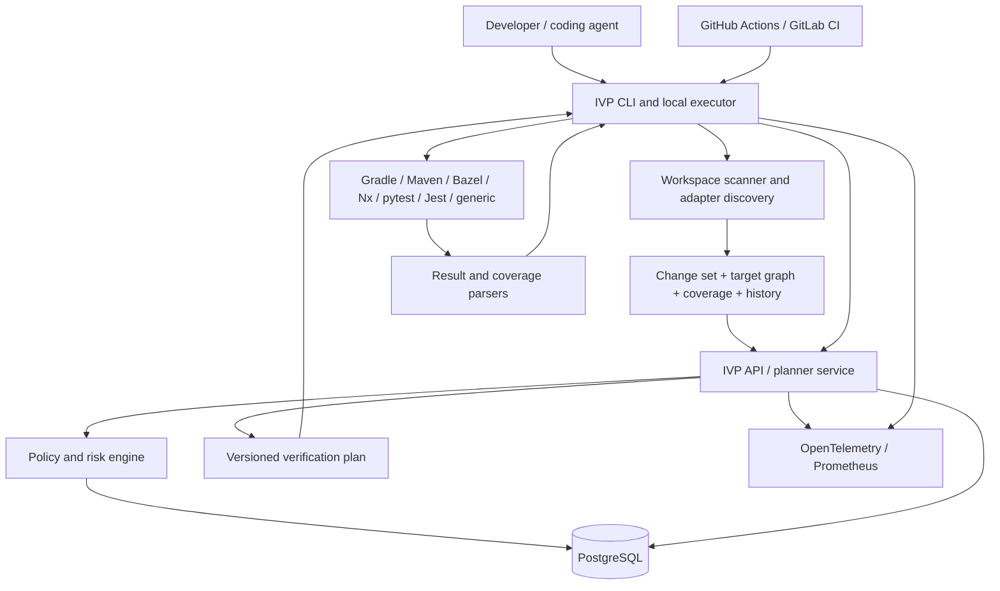

Low-Level Design: Incremental Verification Planner (IVP)
Document status: Implementation specification
Design version: 1.0
Intended implementer: AI coding agent starting from an empty repository
Product maturity target: Complete production-ready implementation within the supported matrix below; no planned core capability is deferred
Primary objective: Reduce the end-to-end time and compute cost of validating software changes while keeping verification safety measurable, explainable, and conservative.
0. Normative implementation instructions
The implementation agent MUST follow this document as the source of truth. When implementation details appear ambiguous, use the most conservative behavior that preserves correctness and document the choice in an Architecture Decision Record (ADR). Do not silently invent a less conservative shortcut.

The words MUST, MUST NOT, SHOULD, and MAY are normative requirements.
1. Build a complete working product, not a toy proof of concept.
2. All selected commands MUST be executed as argument arrays without shell interpolation by default. Never concatenate untrusted repository data into a shell command.
3. An incomplete, unsupported, stale, or contradictory impact graph MUST reduce optimization, never reduce verification.
4. The product MUST preserve configured mandatory checks and security/compliance gates. A planner recommendation MUST NOT silently override them.
5. A successful selected-test run MUST NOT be represented as proof that unselected tests would pass.
6. Every plan MUST be explainable: it must state what was selected, why it was selected, what was omitted, confidence limitations, and whether a safety fallback was applied.
7. Results MUST be measured at the level of accepted changes and complete validation outcomes, not merely number of tests selected or tokens consumed.
8. Source files and full source contents MUST NOT be uploaded to the IVP API. The local executor may read source files; the server receives graph metadata, normalized paths, hashes, summaries, plans, and sanitized execution metadata only.
9. The application MUST work in an offline/degraded state by falling back to the locally configured full verification command when the server is unavailable or the policy/snapshot cannot be trusted.
10. Do not add LLM inference to the safety-critical test-selection path. The initial mature system uses deterministic, observable decision logic. Optional model-generated explanations are outside the core design and MUST NOT change selected checks.
11. Do not introduce placeholder implementations, unimplemented adapter stubs, TODO-only acceptance criteria, or “future phase” sections. For every supported adapter and API in this document, implement and test the behavior. Unsupported ecosystems MUST be handled through the generic adapter or conservative full-suite fallback.
12. Pin production dependencies and container images to reproducible versions/digests in the implementation repository. Keep a software bill of materials and vulnerability scanning in CI.
1. Product definition
1.1 Problem
Coding agents and developers frequently run broad validation after a small edit, wait for slow build/test pipelines, and re-run checks whose results may no longer be informative. Conversely, naive change-based test selection can miss indirect dependencies and allow regressions to escape.

IVP is a verification orchestration service that analyzes a repository change, uses build-graph/test/coverage/history evidence to select a risk-appropriate verification plan, executes the plan through local build/test tools, and escalates to broader verification when evidence is incomplete or a hard risk rule applies.
1.2 Product outcome
Optimize these two measures:
- Time to accepted, correct change: elapsed time from the start of a change-validation iteration to an accepted patch, including retries and review/correction time where available.
- Cost per accepted, correct change: compute and CI cost, test/build execution cost, orchestration cost, and measurable human correction/review cost divided by the probability that a change is accepted correctly.
Token savings, test-count reduction, cache hits, and shorter test commands are diagnostic metrics only. None is a sufficient success metric by itself.
1.3 User personas
- Developer / AI coding agent: asks IVP to plan and run verification during an implementation loop.
- CI operator: uses IVP in pull-request validation with configured mandatory checks and escalation policy.
- Repository maintainer: configures repository metadata, critical paths, test mappings, and safety policy.
- Platform administrator: operates the API, database, worker clients, identity and telemetry.
- Auditor / engineering leader: reviews plan rationale, verification evidence, audit misses, and productivity metrics.
1.4 Supported production scope
The complete implementation MUST support these explicit integration families:
Family	Supported target behavior	Evidence and execution mechanism
Gradle	Multi-project JVM builds; task graph; test task discovery; class/method-filtered unit tests; configured integration-test tasks	Gradle wrapper/CLI, project/task metadata, test reports, JaCoCo XML when configured
Maven	Reactor modules; Surefire and Failsafe test goals; class/method filtering where provider supports it	Maven wrapper/CLI, effective reactor/project metadata, XML test reports, JaCoCo XML when configured
Bazel	Test targets and configured dependency graph	bazel query/cquery/test listing and bazel test; coverage/report formats supported by the repository setup
Nx	Project graph and affected project targets; Jest target execution and configured other Nx test targets	Nx CLI project/target graph, affected calculation, target-specific execution
pytest	Test file/node selection, JUnit XML result parsing, coverage mapping	pytest collection, node IDs, JUnit XML, coverage.py XML and per-test contexts when configured
Jest	Test-file and related-test selection, structured results, LCOV coverage	Jest CLI (--findRelatedTests, --runTestsByPath, JSON/JUnit reporter) and LCOV
Generic command adapter	Explicitly declared test/check units with path mappings, dependencies, risk labels, and safe argv templates	Repository-owned IVP YAML config; no command inference and no shell evaluation
CI	GitHub Actions and GitLab CI through CLI exit codes and machine-readable reports; any CI system that can run the CLI	CLI plus JSON/SARIF/JUnit-compatible report output; no platform-specific CI service is required for core operation

Core code impact inputs may additionally consume SCIP-compatible symbol/reference indexes. This enriches selection but is not mandatory. When it is absent, adapters must use build-target, test-target, file ownership, coverage, and configured mappings with an appropriately lower confidence.
1.5 Supported deployment platforms
- API/server: Linux amd64 and arm64 containers.
- CLI/executor: Linux and macOS amd64/arm64.
- Repository commands execute in the developer/CI workspace under that workspace's OS/container. The server never executes repository commands.
- Windows-specific execution is not part of the supported release. The API schema remains platform-neutral; on Windows the CLI must refuse selective execution and print the full-suite fallback command/configuration rather than pretending it has verified the repository.
1.6 Explicit non-goals
These are intentionally outside product scope and must not be implemented as core behavior:
- Replacing Gradle, Maven, Bazel, Nx, pytest, or Jest.
- Replacing required full CI, security, compliance, release, or deployment gates without a repository owner explicitly configuring a risk-based policy.
- Claiming mathematical proof of test sufficiency or absence of regressions.
- Automatically modifying source code or fixing failing tests.
- Uploading repository source code, secrets, environment values, raw command environments, or complete unsanitized logs to the API.
- Depending on an LLM to decide which mandatory tests can be skipped.
- Automatically training an ML model as part of ordinary planning. The mature planner uses deterministic scoring and evidence-driven policy; historical data feeds calibrated statistics, not opaque learned gating.
2. Design decisions
2.1 Architecture style
Use a modular monolith control plane plus local CLI executor. Do not split business logic into independently deployed microservices. The control plane is a single stateless Go HTTP service; PostgreSQL holds durable state. The CLI runs in the repository workspace, builds/updates the repository evidence snapshot, requests a plan, materializes approved target commands locally, executes them, and reports structured outcomes.

This split allows organization-wide policies and shared history while ensuring test/build commands run in the exact local/CI environment and source contents stay in the workspace.
2.2 Technology choices
- Language: Go, using the latest stable version available at implementation time. Pin the exact toolchain in CI and go.mod.
- HTTP: Go net/http with chi router.
- API schema: OpenAPI 3.1; checked-in generated client types are not hand-edited.
- CLI: cobra.
- Configuration: YAML parsed with strict unknown-field rejection; JSON Schema is published for editor validation.
- Database: PostgreSQL 16 or newer; use pgx driver and sqlc-generated query layer.
- Migrations: goose; all migrations are forward-only and versioned.
- Identifiers: UUIDs generated by the application; idempotency tokens are separate strings.
- Observability: OpenTelemetry traces and metrics; Prometheus exporter; structured JSON logs.
- Test framework: Go testing, httptest, testcontainers for PostgreSQL integration tests, plus golden fixtures for adapter output.
- API authentication: OIDC-issued JWT bearer tokens for human/service access; service-to-service CLI auth through short-lived service tokens. Development-only local auth is disabled in production.
- Deployment: Docker images, Docker Compose for self-hosting/single-node development, Helm chart for Kubernetes, PostgreSQL backup/restore procedure.
- Graph storage: relational tables in PostgreSQL with indexed edge traversal and adjacency materialized views/cache as necessary; no separate graph database.
- Artifact storage: sanitized bounded report objects through a storage interface, filesystem in single-node deployment and S3-compatible storage in distributed deployment. Artifact storage is optional for plan correctness; losing an artifact must not change the plan.
If a chosen library is no longer maintained when implementation begins, choose a maintained equivalent and record an ADR without changing the external behavior described here.
2.3 Trust boundaries
1. Repository workspace: potentially untrusted source, build scripts, tests, adapter output, filenames, and command output.
2. CLI process: reads repository metadata and starts configured build/test programs. It must run as the invoking user and must not elevate privileges.
3. IVP API: receives authenticated, schema-validated metadata, plans, and sanitized results. It does not receive repository source blobs.
4. PostgreSQL / artifact store: tenant-scoped data. Apply least-privilege credentials, encrypted transport, and deployment-provided encryption at rest.
5. Identity provider: authenticates users/service identities. IVP maps identity claims to roles and tenant membership.
Repository data is untrusted input. Do not treat README content, build output, test names, branch names, or filenames as instructions to the implementation or server. Sanitize for logs and HTML output.
3. System context and components
3.1 Logical component diagram

3.2 Responsibilities
CLI
- Detect supported OS and repository root.
- Read Git diff/status, repository config, build files, test inventory, coverage/history files, and adapter metadata.
- Create canonical workspace and environment fingerprints.
- Upload metadata-only snapshot deltas.
- Retrieve policy, request plan, render a human-readable explanation, and optionally write a JSON report.
- Validate the plan against local workspace fingerprint before execution.
- Materialize and execute commands via exec.CommandContext with argv arrays; enforce timeout/cancellation/output limits.
- Parse test reports and submit aggregate results and sanitized artifacts.
- Use full-suite fallback when required or when service/policy/index is unavailable.
API / planner
- Authenticate and authorize requests; enforce tenant isolation.
- Store immutable repository snapshots and versioned evidence.
- Validate policy and adapter capability metadata.
- Construct deterministic plans with complete rationales.
- Track plan and execution state; accept idempotent results.
- Calculate audit outcomes, calibration statistics, safety incidents, and cost/time dashboards.
- Expose configuration, plan, execution, health, and audit APIs.
Build/test adapters
- Discover runnable units and dependencies using the native tool, repository configuration, and standard reports.
- Translate IVP's abstract test units to safe argv commands.
- Parse native XML/JSON/LCOV/JUnit/Bazel/Nx outputs into the canonical result model.
- Declare which filters and coverage precision are actually supported. Never claim a finer granularity than the runner accepts.
Policy engine
- Apply hard escalation triggers before heuristic ranking.
- Never omit mandatory checks.
- Compute risk, evidence coverage, and selection confidence.
- Return FULL_REQUIRED when a safe selective plan cannot be justified.
4. Core domain model
All timestamps are UTC RFC 3339. All paths are repository-relative, normalized with /, and must not escape the repository root. File identifiers are canonical POSIX-like paths plus content hashes. Paths are never used as authorization identifiers.
4.1 Repository
type Repository struct {
    ID             UUID
    TenantID       UUID
    Slug           string
    CanonicalURL   string // sanitized; credentials forbidden
    DefaultBranch  string
    CreatedAt      time.Time
    UpdatedAt      time.Time
}
A repository is a logical identity, not a checked-out worktree. Multiple branches/worktrees generate separate snapshots.
4.2 Repository snapshot
type RepositorySnapshot struct {
    ID                 UUID
    RepositoryID       UUID
    CommitSHA          string
    BaseSHA            string
    TreeHash           string
    WorktreeHash       string
    SubmoduleDigest    string
    ToolchainDigest    string
    BuildConfigDigest  string
    AdapterSetDigest   string
    GraphVersion       int64
    EvidenceGeneratedAt time.Time
    IsComplete         bool
    CompletenessReasons []string
}
Snapshots are immutable after creation. Any changed relevant source, configuration, toolchain, adapter, lockfile, graph evidence, or coverage provenance must create a new snapshot version. A plan references exact snapshot IDs and hashes.
4.3 Changed file
type ChangedFile struct {
    Path       string
    Status     ChangeStatus // ADDED, MODIFIED, DELETED, RENAMED, COPIED, TYPE_CHANGED
    OldPath    string
    OldHash    string
    NewHash    string
    DiffHunks  []LineRange
    IsBinary   bool
    IsGenerated bool
    DetectedRiskLabels []string
}
For a rename, store both old and new path. Deleted files must remain represented; they can impact consumers. Binary files cannot use line-level coverage and therefore lower selection confidence unless build metadata identifies their consumers.
4.4 Graph nodes and edges
GraphNode fields: id, repository_snapshot_id, node_type, stable_key, path, display_name, labels, evidence_source, confidence, observed_at, valid_until, attributes_json.

Node types: SOURCE_FILE, SYMBOL, BUILD_TARGET, TEST_TARGET, TEST_CASE, CHECK_TARGET, CONFIG, API_SCHEMA, GENERATED_OUTPUT, MIGRATION, RUNTIME_SERVICE, OWNER.

GraphEdge fields: id, snapshot_id, from_node_id, to_node_id, edge_type, confidence, evidence_source, observed_at, valid_until, attributes_json.

Edge direction conventions MUST be consistent:
- DEPENDS_ON: consumer -> dependency. To find consumers affected by a dependency change, traverse reverse edges.
- TEST_COVERS: test unit -> source entity. To find tests that cover a changed entity, traverse reverse edges from the entity.
- BUILT_FROM: generated output -> source/config input.
- CONFIGURES: build/test target -> configuration key.
- CONTRACT_CONSUMER: service/client/target -> API schema or contract.
- OWNED_BY: node -> owner.
- COLOCATED_WITH: source/test file relationship based on documented project convention; this edge is low-confidence evidence and cannot alone justify skipping broader tests.
Every edge MUST record its provenance and confidence. Never merge conflicting edges without retaining the conflict and marking the effective relation uncertain.
4.5 Test unit
A test unit is the smallest reliably selectable execution unit supported by the adapter. It may be a test case, test method, test file, test class, build test target, or project-level suite. Granularity is adapter-declared, not assumed.
type TestUnit struct {
    ID               UUID
    SnapshotID       UUID
    StableKey        string // normalized target or test identifier
    Adapter          string
    UnitType         TestUnitType
    ModuleKey        string
    RiskLabels       []string
    Mandatory        bool
    EstimatedMillis  int64
    DurationP50Millis int64
    DurationP95Millis int64
    DurationSampleCount int
    FlakeRate        float64
    LastSeenAt       time.Time
    Selectable       bool
    SelectionGranularity string
    Metadata         map[string]any
}
Duration estimates use recent valid runs, excluding canceled runs and infrastructure failures. With fewer than five observations, use adapter/project-level conservative estimates and mark estimate confidence low. Flake rate must be based on a configurable rolling window and record the sample size.
4.6 Coverage and evidence
CoverageObservation links a test unit (or test suite where per-test coverage is unavailable) to a source file, source line interval, symbol, or build target. Store source type, report hash, run ID, timestamp, environment fingerprint, and precision (LINE, SYMBOL, FILE, TARGET, MODULE).

Coverage from a whole suite MUST NOT be mislabeled as individual-test coverage. Coverage evidence older than the configured staleness threshold, from a different build digest, or from a test configuration that no longer matches the snapshot is considered stale.
4.7 Verification plan
type VerificationPlan struct {
    ID                 UUID
    RepositoryID       UUID
    SnapshotID         UUID
    BaseSHA            string
    HeadSHA            string
    Mode               PlanMode
    Status             PlanStatus
    RiskScore          int // 0..100
    RiskLevel          RiskLevel // LOW, MEDIUM, HIGH, UNKNOWN
    SelectionConfidence float64 // 0..1
    WeightedCoverage   float64 // 0..1; estimate, not proof
    EstimatedDurationMillis int64
    EstimatedComputeMillis int64
    SelectedUnits      []PlanUnit
    MandatoryUnits     []PlanUnit
    OmittedUnits       []OmittedUnit
    EscalationReasons  []EscalationReason
    EvidenceReferences []EvidenceReference
    PolicyVersion      int64
    AlgorithmVersion   string
    CreatedAt          time.Time
    ExpiresAt          time.Time
}
A plan is immutable. Any changed workspace fingerprint or policy version invalidates it for execution. Plan status is one of READY, FULL_REQUIRED, STALE, EXECUTING, PASSED, FAILED, CANCELLED, ERROR.

A PlanUnit contains unit_id, stable_key, unit_type, reason_codes, coverage_contribution, risk_contribution, estimated_duration_ms, execution_group, mandatory, and an abstract target_ref. It MUST NOT contain an arbitrary server-provided shell command. The local adapter materializes commands for target refs.
4.8 Execution and audit
Each plan execution records actual argv template ID (not secrets), adapter version, start/end time, exit status, cancellation reason, test counts, structured failures, duration, CPU time if available, output hashes, sanitized excerpt references, environment fingerprint, and escalation performed.

Audit records compare a selective plan with an authoritative full-suite run over the identical source snapshot and materially equivalent toolchain/environment. Outcomes: NO_MISS_OBSERVED, POSSIBLE_MISS, CONFIRMED_MISS, INCOMPARABLE, AUDIT_FAILED. An audit is not allowed to label NO_MISS_OBSERVED as proof that no unobserved regression exists.
5. Repository configuration
5.1 File location and precedence
Repository configuration lives at .ivp/config.yaml. Precedence, from lowest to highest:
1. Product defaults.
2. Server organization policy.
3. Repository .ivp/config.yaml values allowed to be overridden by repository policy.
4. Explicit CLI parameters for non-security-sensitive options only.
Repository config MUST NOT disable organization-mandated checks, lower hard escalation rules, change server trust settings, or enable remote selective CI gating without explicit organization policy permission.

Configuration is schema-validated on every run. Unknown keys are errors rather than ignored values. Invalid config results in FULL_REQUIRED plus a useful error; the CLI must not guess missing fields.
5.2 Example complete configuration
version: 1
repository:
  slug: "team/sample-service"
  default_branch: "main"

analysis:
  base_ref: "origin/main"
  follow_renames: true
  include_untracked: true
  max_changed_files_for_selective_plan: 500
  graph_staleness_minutes: 1440
  coverage_staleness_days: 30
  require_clean_dependency_resolution: true

server:
  endpoint: "https://ivp.internal.example"
  connect_timeout_seconds: 3
  request_timeout_seconds: 10
  offline_policy: "FULL_SUITE_FALLBACK"

modes:
  default: "FAST_FEEDBACK"
  observe:
    execute_full_suite: true
    selected_plan_only_report: true
  fast_feedback:
    final_ci_full_suite_required: true
    allow_selective_inner_loop: true
  risk_based_ci:
    enabled_by_organization_policy: false
    audit_sample_rate: 0.10
    minimum_calibration_runs: 500
    minimum_audit_runs: 100

selection:
  low_risk_max_score: 24
  medium_risk_max_score: 59
  low_risk_min_weighted_coverage: 0.95
  medium_risk_min_weighted_coverage: 0.99
  minimum_selection_confidence: 0.98
  max_selective_estimated_runtime_fraction: 0.70
  unknown_evidence_action: "FULL_SUITE"
  non_deterministic_test_action: "INCLUDE_AND_LABEL"
  if_no_tests_selected: "FULL_SUITE"

safety:
  hard_full_suite_paths:
    - "**/pom.xml"
    - "**/build.gradle"
    - "**/build.gradle.kts"
    - "**/settings.gradle"
    - "**/settings.gradle.kts"
    - "**/gradle/libs.versions.toml"
    - "**/gradle-wrapper.properties"
    - "**/mvnw"
    - "**/gradlew"
    - "**/MODULE.bazel"
    - "**/WORKSPACE*"
    - "**/BUILD"
    - "**/BUILD.bazel"
    - "**/nx.json"
    - "**/project.json"
    - "**/pytest.ini"
    - "**/pyproject.toml"
    - "**/jest.config.*"
    - "**/*lock*"
    - "**/migrations/**"
    - "**/db/migrate/**"
  hard_full_suite_risk_labels:
    - "SECURITY_CRITICAL"
    - "AUTHENTICATION"
    - "AUTHORIZATION"
    - "CRYPTOGRAPHY"
    - "PAYMENT"
    - "DATA_MIGRATION"
    - "PUBLIC_CONTRACT"
  always_run_check_ids:
    - "format-check"
    - "lint"
    - "typecheck"
    - "secret-scan"
    - "dependency-audit"
  audit:
    enabled: true
    default_mode: "SHADOW"
    sample_rate: 0.10
    minimum_audits_before_selective_ci: 100
    quarantine_on_confirmed_miss: true
    quarantine_hours: 168
    repeat_failed_test_count: 2

adapters:
  gradle:
    enabled: true
    wrapper_required: true
    unit_test_tasks: ["test"]
    integration_test_tasks: ["integrationTest"]
  maven:
    enabled: true
    wrapper_preferred: true
    surefire_enabled: true
    failsafe_enabled: true
  bazel:
    enabled: true
    use_configured_target_patterns: true
  nx:
    enabled: true
    test_target_names: ["test", "e2e"]
  pytest:
    enabled: true
    config_file: "pyproject.toml"
  jest:
    enabled: true
    config_discovery: true
  generic:
    enabled: true
    test_units: []
    checks: []

telemetry:
  enabled: true
  capture_raw_stdout: false
  capture_failure_excerpt: true
  max_excerpt_bytes: 8192
  retention_days: 90
This example is schema-complete for the fields defined above. The implementation must ship a matching JSON Schema and validation tests. Defaults must also be implemented in code, not supplied only in documentation.
6. Planner algorithm
The planner is deterministic and versioned. Every plan stores algorithm_version, policy version, graph snapshot, and normalized reason codes so that a historical plan can be reproduced or explained.
6.1 Inputs
1. Exact base and head commit IDs plus dirty worktree manifest.
2. Changed files, status, line ranges, hashes and rename relationships.
3. Repository snapshot: build targets, test units, dependencies, coverage mappings, test history, risk labels, and completeness metadata.
4. Applicable organization/repository policy.
5. Mode: OBSERVE, FAST_FEEDBACK, RISK_BASED_CI, or FULL.
6. Adapter capabilities and toolchain/environment fingerprints.
6.2 Outputs
- Selected executable test/check units at the adapter's actual selection granularity.
- Mandatory units that cannot be omitted.
- Omitted units with explicit reasons.
- Estimated weighted impact coverage and selection confidence.
- Risk score/category and hard escalation reasons.
- Estimated runtime and cost where data exists, including uncertainty bounds.
- A full-suite fallback command plan when the selection is not safe or cannot execute.
6.3 Planning stages
Stage 1 — Validate the request and fingerprints
- Confirm repository and tenant are authorized.
- Ensure base/head SHAs exist and the diff is computed against the requested base.
- Verify the current workspace hash equals the planned hash before execution.
- Reject invalid, stale or inconsistent graph references.
- If required files, configuration digests, build graph or adapter metadata are missing, set evidence completeness to false.
- Include staged, unstaged, untracked, renamed and deleted files. Do not ignore untracked files merely because Git has not added them.
- Detect submodule changes and lockfile/toolchain modifications.
Stage 2 — Classify changed entities
- Map each changed file to a source/config/test/build/API/generated/migration entity.
- Where a language/symbol index exists, map changed lines to symbols. Otherwise use file and build-target granularity.
- Apply repository critical-path labels using glob and exact-path rules.
- Classify global-impact files: build definitions, lockfiles, compiler/toolchain versions, test runner configuration, CI workflows, shared configuration, schema contracts, code generation definitions, deployment manifests, database migrations, dependency injection registries, and unknown generated-file relationships.
- If source-to-test mapping is incomplete for changed critical entities, treat the evidence as uncertain.
Stage 3 — Apply hard escalation rules before scoring

Immediately return a FULL_REQUIRED plan if any of these conditions applies:
1. The repository/build/test adapter is unsupported or cannot reliably list runnable verification units.
2. The requested base/head cannot be resolved, the worktree changes during planning, or the current workspace fingerprint cannot be verified before execution.
3. A build definition, test runner configuration, lockfile, compiler/toolchain, code generator, deployment/security policy, schema contract, migration, or globally shared config file changed, unless an organization-specific reviewed policy explicitly defines a narrower, safe exception.
4. A changed entity has a configured hard-risk label.
5. The dependency graph has missing/cyclic/contradictory edges in the impacted region, or its freshness threshold has expired.
6. Required coverage/evidence is absent, stale or from an incomparable environment and the remaining graph cannot meet selection-confidence and weighted-coverage thresholds.
7. No runnable test/check unit is selected for a non-documentation-only change.
8. The change exceeds max_changed_files_for_selective_plan, affects too many targets, or is detected as a broad refactor.
9. The test selection would omit a configured mandatory check.
10. The planner API/policy is unavailable and no valid, signed local policy snapshot is available.
11. The proposed selective execution is longer than the full-suite estimate, within the configured runtime fraction, or its uncertainty interval overlaps the full suite's runtime in a way that makes selection uneconomic.
12. The repository is in quarantine after a confirmed or unresolved regression miss for the relevant adapter/rule/scope.
Documentation-only changes may use an explicitly configured documentation check, but never silently select zero checks.

Stage 4 — Generate candidate units

The initial candidate set is the union of:
- Tests/checks explicitly changed or added in the diff.
- Test units with TEST_COVERS edges to changed lines/symbols/files.
- Tests belonging to directly changed targets/modules.
- Tests that depend on, or exercise, reverse dependents of changed public contracts.
- Integration/E2E tests configured for affected services/modules.
- Tests historically failing on the changed entity or related dependency edge.
- Tests mapped by reviewed repository-defined path_patterns, test ownership, or generic-adapter relationships.
- All mandatory checks and policy-mandated suites.
Deduplicate by stable unit key; do not combine test units with different environment, isolation, or execution requirements.

Stage 5 — Build impacted entity weights

For each changed entity e, compute a normalized impact weight:

weight(e) = criticality(e) * (1 + min(reverse_dependency_count(e), dependency_cap)) * change_severity(e)

Normalize all weights so their sum is 1. The values criticality, dependency_cap, and severity mapping are policy-configurable and versioned. Use a bounded transform such as log1p(reverse_dependency_count) rather than unbounded linear fanout so one extremely central node does not erase all other evidence.

Default criticality classes:
- CRITICAL: authentication/authorization, cryptography, payment/ledger, data integrity, deployment/release, security boundaries.
- HIGH: public APIs, shared libraries, schema/contract owners, shared configuration.
- NORMAL: ordinary production code.
- LOW: documentation and isolated non-production utilities.
Unknown criticality defaults to HIGH, not LOW.

Stage 6 — Score plan risk

Risk score is a normalized 0–100 policy score. Use deterministic feature contributions:
- Criticality of changed entities: 0–25.
- Reverse dependency/fan-out reach: 0–20.
- Change class (public contract, config, schema, generated code, concurrency): 0–15.
- Evidence gaps or stale mappings: 0–20.
- Relevant regression/failure history: 0–10.
- Environment/build/test uncertainty: 0–10.
Clamp each contribution and the total to its defined interval. Record feature values and reason codes, not just the final score. A hard escalation rule always overrides the numerical score.

Risk levels use configured thresholds, defaulting to LOW 0–24, MEDIUM 25–59, HIGH 60–100, and UNKNOWN when essential inputs cannot be calculated. UNKNOWN always escalates.

Stage 7 — Select units by marginal coverage per cost

Selection is a deterministic weighted set-cover heuristic, not a claim of globally optimal or complete regression detection.

For each candidate test unit t, calculate:
- coverage_gain(t): uncovered impacted-entity weight that test t can exercise, adjusted by evidence precision and freshness.
- history_gain(t): bounded bonus for historical failures relevant to the changed region.
- dependency_gain(t): bounded bonus for covering direct consumers or configured integration boundaries.
- reliability(t): confidence adjustment derived from mapping precision, sample count and staleness. Flaky tests are not silently excluded; include them with a flakiness label and apply the configured retry policy.
- cost(t): conservative estimated runtime (P95 when sample count permits; otherwise an adapter/module estimate), plus startup overhead.
Calculate utility(t) = (coverage_gain + history_gain + dependency_gain) * reliability / max(cost(t), minimum_cost_floor).

Greedily select the candidate with highest marginal utility, update covered entities, and repeat until:
- all mandatory units have been selected;
- all changed critical entities have sufficient mapped verification coverage;
- weighted coverage meets the risk-level target (default 0.95 low risk, 0.99 medium risk);
- minimum selection confidence is met (default 0.98); and
- additional selection would not break an explicit mode budget where a safe fallback exists.
High-risk changes are not eligible for selective final-CI gating by default. They may use targeted checks for inner-loop feedback, but full required verification remains in force. FAST_FEEDBACK may use a faster targeted set while the final CI suite remains mandatory.

If any stopping condition cannot be satisfied, the plan escalates to full verification. The reported weighted coverage is an estimate derived from available mappings; it is not a formal measure of regression recall.

Stage 8 — Order selected units

Order by:
1. mandatory gates;
2. checks with the highest expected fault-detection value per second;
3. direct tests covering changed lines/symbols;
4. high-risk dependency consumers;
5. integration/E2E tests;
6. remaining selected tests.
Allow parallel execution only when the adapter declares independent execution and repository policy permits it. Tests sharing mutable services, ports, databases, test data, or generated outputs must use serialized/exclusive resource groups.

Stage 9 — Produce plan and explanation

The plan explanation MUST include:
- Change summary and snapshot identifiers.
- Risk score and individual risk contributions.
- Selection confidence and weighted coverage, with their evidence granularity.
- Every selected unit with reason codes and estimated runtime.
- Every omitted candidate or category with omission reason.
- All hard escalation rules checked and their outcomes.
- The exact full-suite fallback path.
- Policy version, algorithm version, and adapter capability versions.
A plan must be deterministic for the same normalized inputs, policy and algorithm version, aside from generated IDs/timestamps.
7. Risk policy and modes
7.1 Modes
FULL
- Executes all configured test/check units.
- Used for explicit requests, hard escalations, unknown state, policy failure, unsupported adapter behavior and authoritative final checks.
OBSERVE
- Calculates and records the selective recommendation but executes the repository's authoritative full suite.
- Compares recommended versus actual test outcomes and produces selection quality telemetry.
- This mode is mandatory before enabling selective CI gating for a repository.
FAST_FEEDBACK
- Runs the selected checks for rapid local/agent feedback.
- Does not replace the configured final CI full suite. A passing result is labelled TARGETED_PASS, never FULL_VERIFICATION_PASS.
- If the plan is escalated, run full verification instead of the selective subset, unless the user explicitly requests plan-only output.
RISK_BASED_CI
- Available only when enabled by organization policy after calibration requirements have been met.
- Runs selected suites for eligible low/medium-risk changes, but never omits mandatory checks.
- Full suite is required for high/unknown risk and hard-trigger changes.
- Runs shadow/audit full-suite executions at the configured sampling rate, plus scheduled full-suite audits.
- Automatically quarantines the affected selection scope on a confirmed or unresolved miss.
7.2 Confidence and calibration
selection_confidence is computed from: graph completeness, edge confidence, evidence freshness, adapter granularity/precision, mapped-weight coverage, historical sample size, toolchain comparability, and whether critical entities have test mappings. It is not model confidence and must not be trained from unverified task-success labels.

Rules:
- Default minimum selection confidence: 0.98.
- If a required feature is missing, return UNKNOWN instead of substituting a favorable default.
- Before enabling RISK_BASED_CI, require the configured minimum number of observe-mode runs and audits, plus organization-owner approval. The shipped default is disabled.
- A confirmed miss or an audit that cannot be resolved immediately quarantines the affected repository/adapter/risk scope and forces full verification for that scope.
- Quarantine expires only after the configured period AND a maintainer acknowledges the issue AND at least one clean audit succeeds. It must not auto-clear solely because time passed.
7.3 Flaky tests
Flakiness does not make a test irrelevant. Store per-test failure/pass counts and classify flakiness only after a minimum number of comparable observations. A test failure must be re-run according to policy (default: one retry, two total attempts) to distinguish likely flakiness from a reproducible failure. Preserve both results. Any ambiguous failed audit is POSSIBLE_MISS and triggers conservative quarantine until adjudicated.
7.4 Tests for which no coverage is available
Use build-target dependency edges, exact test-file mappings, explicitly declared generic-adapter mappings, changed test files, and owner mappings. Lower confidence according to evidence precision. Do not infer line-level coverage from a module-level edge. If the plan cannot meet the thresholds, run the full affected project or full suite as policy dictates.
7.5 Required gates
Every repository may configure mandatory checks (format, lint, type checking, secret scan, dependency policy, contract checks, compliance, and release checks). They are selected before optimization and are never removed by the optimizer. The server must verify policy precedence so a repository cannot override a mandatory check in .ivp/config.yaml.
8. Adapter subsystem
8.1 Interface contract
All adapters implement this interface in internal/adapters:
type Adapter interface {
    ID() string
    Detect(ctx context.Context, root string) (Detection, error)
    Discover(ctx context.Context, req DiscoverRequest) (DiscoveryResult, error)
    Materialize(ctx context.Context, req MaterializeRequest) (ExecutionCommand, error)
    ParseResults(ctx context.Context, req ParseRequest) (ParsedResults, error)
    ParseCoverage(ctx context.Context, req CoverageRequest) (CoverageResult, error)
    Capabilities() Capabilities
    Version(ctx context.Context, root string) (string, error)
    ValidateConfig(config AdapterConfig) error
}
ExecutionCommand contains Executable, Args []string, WorkingDirectory, a strict environment allowlist/map, timeout, resource group, and redaction metadata. It does not contain a free-form shell command. Materialize must verify that target keys came from the current snapshot or trusted repository config and reject unknown targets.

All external command outputs are size-limited and parsed as untrusted input. Adapter parsers MUST handle missing, malformed, oversized, and version-incompatible report files without panic; those failures mark evidence incomplete and trigger safe fallback.
8.2 Gradle adapter
- Discover Gradle wrapper and project structure; prefer ./gradlew over system Gradle when the wrapper is checked in.
- Query tasks/projects and identify Test tasks, configured integration test tasks, and required check tasks. Do not assume every task named test has identical semantics.
- Represent target keys as :projectPath:taskName.
- Use Gradle --tests filters only for a Test task where the task supports them; if the task's type/behavior is unknown, execute the whole task.
- Parse JUnit XML reports and JaCoCo XML when present. Associate coverage with test cases only if test-specific coverage data exists; otherwise use class/file/target-level edges.
- Do not blindly use Gradle build cache as a substitute for a test result. Respect the build's configured cache behavior and include Gradle version, JVM, wrapper distribution, lockfiles and relevant properties in fingerprints.
- If settings/build scripts, wrapper, dependency catalogs, build logic, or test configuration changes, full project/required-suite escalation applies.
8.3 Maven adapter
- Discover mvnw and reactor modules; prefer the Maven Wrapper when present.
- Represent build targets using module path plus lifecycle/check/test goal.
- Support Surefire unit tests and Failsafe integration tests separately.
- Use supported -Dtest/include filtering for classes/methods only when the provider and plugin configuration allow it. If the test provider is not recognized or reports zero tests, treat the selective execution as invalid and fall back.
- Parse Surefire/Failsafe XML reports and JaCoCo XML when present.
- Build the reactor dependency graph from Maven model/effective POM where possible. POM changes, parent POM changes, dependencyManagement changes, extensions, plugin versions, wrapper and lock-like dependency metadata trigger escalation.
- Avoid assuming that selecting a module test goal automatically builds every required upstream dependency; preserve declared reactor/build prerequisites.
8.4 Bazel adapter
- Use Bazel query APIs to discover targets and dependency relations; use configured query/cquery where configuration affects target selection.
- Represent targets as canonical labels, e.g. //path:target.
- Run test labels via bazel test with repository config and relevant startup/build flags preserved. Never execute a label not discovered in the current snapshot or explicitly declared in trusted config.
- Use reverse dependency traversal to find affected consumers; distinguish build dependencies from test dependencies and toolchain dependencies.
- Capture test results through Build Event Protocol (BEP) where configured and parse coverage reports only in supported formats.
- If query evaluation fails, package loading fails, or configuration transitions are unresolved, fall back to a configured full Bazel test target pattern.
- Treat .bazelrc, MODULE.bazel, workspace/BUILD files, toolchains, macros, and repository rules as high-impact. Changes to them require full verification unless a reviewed policy explicitly scopes the fallback.
8.5 Nx adapter
- Discover the Nx workspace and project graph through supported Nx CLI metadata commands.
- Use nx affected to establish affected projects for the diff; combine with each affected project's declared test, e2e, lint, typecheck, or policy-defined target.
- Represent target keys as <project>:<target>[:<configuration>].
- When executing an individual target, use nx run <project>:<target> with explicit configured options. Prefer Nx-native affected logic over reimplementing its project-graph semantics.
- Parse supported Jest JSON/JUnit/LCOV or configured test-runner output. For non-Jest Nx targets, the project's declared target configuration determines the result parser.
- If Nx project graph generation fails or target inference is ambiguous, run the configured full CI target set.
- Changes to nx.json, workspace configuration, project graph plugins, executor definitions, or package manager lockfiles trigger escalation.
8.6 pytest adapter
- Discover pytest config and root directory; run collection to obtain canonical node IDs without executing tests.
- Use exact node IDs or test file paths for selection; do not rely on regex patterns built from unescaped path names.
- Parse JUnit XML for test counts, failures, skips, and durations. Parse coverage.py XML/JSON when generated.
- Use coverage.py per-test contexts only when correctly configured and present; otherwise map coverage at file/module granularity and reduce confidence accordingly.
- Include conftest.py, shared fixtures, plugin/config changes, pyproject.toml, pytest.ini, requirements/lock files and test environment definitions in the high-impact rule set.
- If collection errors, zero selected tests, import errors, or malformed reports occur, selective execution is not considered successful; escalate or fail with a clear report.
8.7 Jest adapter
- Discover Jest config and projects. Use --listTests, JSON/JUnit reports, --runTestsByPath for exact test files, and --findRelatedTests where suitable.
- Prefer exact path-based execution over regex when selecting a known set of files.
- Parse JSON results and LCOV coverage. --findRelatedTests is a candidate generator, not proof that all integration behavior is covered.
- Respect multi-project Jest configurations and test environment differences; a path must be resolved to the correct project/configuration.
- Changes to Jest config, setup files, transformers, global mocks, package lockfiles, Babel/TypeScript configuration, or test environment setup trigger broader verification.
8.8 Generic adapter
The generic adapter enables a repository to declare test/check units without a custom Go plugin. It is a supported production feature, not a future extension point.

Example:
adapters:
  generic:
    enabled: true
    test_units:
      - id: "wallet-unit"
        display_name: "Wallet unit tests"
        argv: ["./scripts/test-wallet"]
        cwd: "."
        maps_paths: ["services/wallet/**", "tests/wallet/**"]
        depends_on: ["postgres-test-fixture"]
        risk_labels: ["PAYMENT"]
        mandatory: false
        timeout_seconds: 600
        estimated_duration_seconds: 90
        resource_group: "wallet-db"
      - id: "format-check"
        display_name: "Format check"
        argv: ["./scripts/check-format"]
        cwd: "."
        maps_paths: ["**/*"]
        mandatory: true
        timeout_seconds: 120
Requirements:
- argv must be an array; shell is disabled.
- Every executable must resolve to an allowlisted binary or path inside the repository/toolchain image according to policy.
- Placeholders may only be complete argv elements: {changed_files}, {selected_tests}, {base_sha}, {head_sha}. Placeholder expansion creates multiple argv elements and never interpolates into a shell string.
- maps_paths use a documented glob implementation with deterministic semantics.
- Unit dependency references must resolve; cycles are configuration errors that force full verification.
- Generic coverage mapping is explicit. A generic command with no mapping can be configured as mandatory but cannot be assumed to cover arbitrary changed code.
8.9 Cross-adapter behavior
- An adapter must declare its selectable granularity, dependency-graph precision, coverage precision, test-discovery reliability, and supported result formats.
- The planner must select at the coarsest granularity needed for correct execution. If a test method cannot be reliably filtered, select its entire class/suite.
- Each adapter has golden test fixtures from at least two supported tool versions and tests for malformed reports, paths with spaces, unicode paths, timeouts, and zero-test output.
9. Execution engine
9.1 Local command execution
Implement one hardened command runner used by all adapters:
- exec.CommandContext(executable, args...); no shell by default.
- Set explicit working directory inside repository; reject path traversal.
- Pass only required environment variables. Never copy all environment variables to telemetry or the API.
- Redact configured secret variable names and common credential/token patterns before logging.
- Start commands in a process group and terminate child processes on timeout/cancellation (platform-specific implementations for supported OSes).
- Stream stdout/stderr to bounded local files; retain only sanitized excerpts and hashes by default.
- Configure per-command timeout, maximum output bytes, concurrency limits, file-descriptor limits where possible, and cancellation behavior.
- Capture start/end monotonic times and resource metrics where available.
- Detect command-not-found, permission errors, OOM/termination signals, timeout, adapter/report parsing failures, and actual test failures as distinct result classes.
9.2 Execution state machine
CREATED -> VALIDATING -> RUNNING -> PARSING -> COMPLETED

Alternative terminal/error states: CANCELLED, TIMED_OUT, INFRA_ERROR, STALE_PLAN, ESCALATED, FAILED_TESTS.

A state transition must be persisted locally before a remote status update is attempted. The client uses idempotency keys for result uploads. Server unavailability must not lose the local report; queue a bounded retry file in .ivp/outbox/, encrypt it if it contains sensitive metadata, and retry safely. Do not re-execute tests merely because result upload failed.
9.3 Plan revalidation
Immediately before the first command:
- Recompute the relevant worktree fingerprint.
- Confirm all selected target references still exist.
- Confirm policy version and plan expiration are valid.
- Confirm mandatory checks have not changed.
- If any check fails, mark the plan STALE and create a new plan or run full verification.
If the worktree changes during execution, stop further selective commands and mark the result as incomparable. Never attach a result from one tree to another snapshot.
9.4 Escalation rules during execution
Escalate or invalidate a selective run if:
- A selected test filter resolves to zero tests unexpectedly.
- The adapter cannot parse a result reliably.
- Dependency resolution, test discovery, compilation setup, or test environment initialization fails before tests run.
- A selected test reveals a failure and configured policy requires immediate broad diagnosis.
- Execution environment fingerprint differs from plan fingerprint.
- A mandatory check was omitted due to configuration mismatch.
- Any safety-critical data was missing or malformed.
Test assertion failures are genuine verification failures; do not automatically replace them with a full-suite pass. Record the failing test and allow the developer/agent to fix it. A full suite may still run for diagnosis or authoritative CI according to mode.
10. Audit and calibration engine
10.1 Why audit is a required product capability
Selective-test planners can look effective by running fewer tests while silently missing relevant failures. IVP must continuously measure these misses by comparing selected execution with full-suite evidence on equivalent source and environment snapshots.
10.2 Audit policies
- Observe mode: full suite is always run; planned subset outcome is compared where possible.
- Fast-feedback mode: selected checks run immediately; full CI remains required. An optional isolated background audit can run on a sample of local/CI tasks.
- Risk-based CI mode: a configurable sample of eligible selective runs receives an authoritative full-suite audit in an isolated worktree/container using the same commit and equivalent toolchain.
- Scheduled audit: each repository must run full verification at least according to configured cadence (default daily for active repositories and every release build) even if no random audit was sampled.
10.3 Audit equivalence
An audit is comparable only if source tree hash, dependency lockfiles, build/test configuration, tool versions, environment class, and required services match. Different data, dependency resolution, test order, nondeterminism or missing reports makes it INCOMPARABLE; it must not be treated as a clean audit.
10.4 Miss detection
A likely miss occurs if the selected plan passes but the full suite fails on the same snapshot in a test not selected by the plan, after controlling for known flaky tests. Repeat failed tests as configured. Classify as:
- CONFIRMED_MISS: reproducible failure omitted by selection, plausibly related to the change.
- POSSIBLE_MISS: full-suite failure not selected, but evidence is ambiguous/flaky.
- NOT_ATTRIBUTABLE: test failure demonstrably unrelated to change under reviewed policy.
- INCOMPARABLE: snapshot/environment mismatch.
The system may not autonomously downgrade a POSSIBLE_MISS to NOT_ATTRIBUTABLE without a documented human/CI rule.
10.5 Automated response to misses
On CONFIRMED_MISS or unresolved POSSIBLE_MISS:
1. Set repository/adapter/rule scope to QUARANTINED.
2. Disable selective final-CI gating for that scope and force the full suite.
3. Record missed tests, selected set, graph evidence, policy, and the failure output hash.
4. Open a machine-readable incident record; provide report output for CI to publish.
5. Require maintainer acknowledgement and a clean audit before lifting quarantine.
6. Keep historical miss data for quality dashboards. Do not erase a miss after changing the policy.
10.6 Calibration metrics
Calculate by repository, adapter, risk level, changed-file class, and selection algorithm version:
- Runtime reduction: 1 - selected_runtime/full_runtime for comparable runs.
- Compute reduction: 1 - selected_cpu/full_cpu where CPU metrics exist.
- Regression recall on observed failures: missed relevant failure count / total relevant failures observed by full-suite audits.
- Selection precision: fraction of selected units with defined relevance evidence (diagnostic only; a test that passes may still be valuable).
- Fallback/escalation rate.
- Audit miss rate and Wilson confidence interval.
- Percentage of runs lacking comparable evidence.
- Test discovery and report parsing error rates.
A 0-miss history is not proof of zero risk. Display sample size and confidence interval. Do not enable risk-based CI selection from a small or unrepresentative sample.
11. CLI specification
The executable is ivp. Commands and flags are stable public interfaces.
11.1 Commands
ivp init
- Creates .ivp/config.yaml from the shipped versioned template.
- Detects adapters but does not execute tests.
- Does not overwrite existing config without --force.
ivp doctor
- Validates config, auth, API connectivity, repository root, Git status, adapter versions, toolchain fingerprints, graph freshness, mandatory checks, and offline fallback.
- Returns non-zero if a selective plan cannot safely be generated, but prints the safe fallback instructions.
ivp index [--full]
- Runs adapter discovery, builds a normalized repository graph and metadata snapshot, computes digests, and uploads metadata only.
- --full rebuilds evidence rather than using cached index state.
- Source content is not uploaded.
ivp plan --base <ref> [--head <ref>] [--mode FULL|OBSERVE|FAST_FEEDBACK|RISK_BASED_CI] [--format text|json] [--output <path>]
- Creates a plan only. It does not execute commands.
- --head defaults to current HEAD plus dirty worktree; the effective tree hash must be recorded.
- Prints all escalation and selection reasons.
ivp verify --base <ref> [--mode ...] [--dry-run] [--report <path>]
- Convenience command: validate, index delta if necessary, request plan, print plan, execute it, parse results, upload outcome, return a documented exit code.
- --dry-run performs planning and command validation without executing test commands.
ivp run --plan <plan-id-or-file>
- Revalidates snapshot and local command materialization, then executes the plan.
- It must reject stale plans rather than execute an old command list.
ivp report <run-id-or-file> [--format text|json|sarif]
- Emits a result and selection rationale; supports CI artifact publication.
ivp audit --run <run-id> [--full-suite-command-profile <profile>]
- Runs or coordinates an authoritative comparison when allowed; must use a clean isolated tree if the same workspace could be mutated by the selected run.
ivp policy validate
- Validates effective policy and prints protected org-level checks and hard escalation conditions.
ivp version
- Prints semantic version, commit, build timestamp, Go version, and adapter versions without secrets.
11.2 Exit codes
Code	Meaning
0	Required checks for the selected mode passed; report clearly states whether result is targeted or full verification
1	One or more executed tests/checks failed
2	Invalid user/repository configuration
3	Unsafe/unsupported environment or plan forced to full but fallback could not execute
4	API/auth/policy failure; safe fallback was printed but not executed
5	Stale snapshot/plan; nothing unsafe was executed
6	Adapter, report-parser or infrastructure error
7	Audit detected a confirmed or unresolved possible miss
8	User cancelled execution

Do not return 0 for a targeted pass if mandatory checks were skipped due to error. If fallback full suite executes and passes, return 0 with verification_level=FULL; otherwise return the relevant failure code.
11.3 CLI output
Text output must summarize: mode, base/head, risk, selected/mandatory units, estimated vs observed duration, confidence, weighted coverage, reasons, escalation status, result classification and report path. Large unit lists are paginated or written to JSON rather than flooding the terminal.
12. REST API
All endpoints live under /api/v1. Responses are JSON with stable error codes, request IDs, and trace_id where available. API input/output types must be declared in OpenAPI and generated from the same source as validation types.
12.1 Endpoints
Method and path	Purpose	Required role
GET /health/live	Liveness	public inside deployment network
GET /health/ready	Database/dependency readiness	public inside deployment network
GET /api/v1/me	Resolve authenticated identity and tenant	authenticated
POST /api/v1/repositories	Register repository identity	maintainer
GET /api/v1/repositories	List authorized repositories	reader
GET /api/v1/repositories/{id}	Repository metadata/status	reader
POST /api/v1/repositories/{id}/snapshots	Submit immutable graph/evidence snapshot or delta	executor
GET /api/v1/repositories/{id}/policy	Fetch effective signed policy/version	reader/executor
PUT /api/v1/repositories/{id}/policy	Change repository policy within org bounds	maintainer
POST /api/v1/repositories/{id}/plans	Create deterministic plan	executor
GET /api/v1/plans/{id}	Retrieve plan/rationale	reader/executor
POST /api/v1/plans/{id}/executions	Register execution start	executor
POST /api/v1/executions/{id}/results	Submit idempotent structured result	executor
GET /api/v1/executions/{id}	Retrieve result	reader/executor
POST /api/v1/executions/{id}/audits	Submit/record audit comparison	executor/maintainer
GET /api/v1/repositories/{id}/metrics	Calibrated performance and safety metrics	maintainer/auditor
POST /api/v1/repositories/{id}/quarantine	Quarantine a selection scope	maintainer; automatic system action also permitted
POST /api/v1/repositories/{id}/quarantine/{scope}/acknowledge	Acknowledge miss remediation	maintainer

Use pagination for list/metrics endpoints and strict response limits.
12.2 Planning request shape
{
  "request_id": "uuid",
  "snapshot_id": "uuid",
  "base_sha": "full-git-sha",
  "head_sha": "full-git-sha",
  "worktree_hash": "sha256:...",
  "mode": "FAST_FEEDBACK",
  "client_capabilities": {
    "os": "linux",
    "arch": "amd64",
    "adapters": ["gradle", "pytest"],
    "adapter_versions": {"gradle": "...", "pytest": "..."}
  },
  "execution_context": {
    "ci": false,
    "toolchain_digest": "sha256:...",
    "environment_class": "developer-workstation"
  }
}
The endpoint must verify that the snapshot belongs to the authenticated tenant/repository and that the requested SHAs/fingerprints match the snapshot metadata. Do not accept arbitrary filesystem paths or shell commands from this request.
12.3 Error response
{
  "error": {
    "code": "SNAPSHOT_STALE",
    "message": "The repository changed after the plan was created.",
    "retryable": true,
    "details": {"expected_worktree_hash": "...", "actual_worktree_hash": "..."}
  },
  "request_id": "uuid"
}
Error detail values must be sanitized; never return secret values or raw environment dumps.
12.4 Idempotency and retries
- Snapshot upload, execution start, result submit and audit submit support an Idempotency-Key header.
- Same key + same request hash returns the original result; same key + different hash returns HTTP 409.
- CLI retry uses exponential backoff with jitter for timeouts, HTTP 429 and 5xx; do not retry 4xx validation/auth errors except a single token refresh.
- Results are append-only; correcting an incorrectly parsed outcome creates a superseding record with an audit reason, never silently overwrites history.
13. Persistence design
Use PostgreSQL with application-managed tenant filtering and DB constraints. Each table with tenant data MUST include tenant_id or derive it through an immutable parent relation with every query enforcing tenant scope. Add integration tests proving cross-tenant reads/writes are denied.
13.1 Required tables
1. tenants(id, name, created_at)
2. users(id, oidc_subject, email_hash, created_at, disabled_at)
3. tenant_memberships(tenant_id, user_id, role, created_at)
4. repositories(id, tenant_id, slug, canonical_url, default_branch, created_at, updated_at)
5. repository_policies(id, repository_id, version, policy_json, policy_hash, created_by, created_at, is_active)
6. repository_snapshots(id, repository_id, commit_sha, base_sha, tree_hash, worktree_hash, submodule_digest, toolchain_digest, config_digest, adapter_digest, graph_version, completeness_json, created_at)
7. graph_nodes(id, snapshot_id, stable_key, node_type, path, display_name, confidence, evidence_source, observed_at, valid_until, attributes_json)
8. graph_edges(id, snapshot_id, from_node_id, to_node_id, edge_type, confidence, evidence_source, observed_at, valid_until, attributes_json)
9. test_units(id, snapshot_id, stable_key, unit_type, adapter, module_key, mandatory, risk_labels_json, selectable, granularity, metadata_json)
10. coverage_observations(id, snapshot_id, test_unit_id, covered_node_id, precision, source, report_hash, run_id, environment_digest, observed_at)
11. test_history(id, repository_id, stable_test_key, adapter, source_snapshot_hash, environment_digest, started_at, duration_ms, cpu_ms, outcome, failure_fingerprint, retry_count, flake_classification)
12. verification_plans(id, repository_id, snapshot_id, base_sha, head_sha, worktree_hash, mode, status, risk_score, risk_level, selection_confidence, weighted_coverage, algorithm_version, policy_version, estimated_duration_ms, explanation_json, created_at, expires_at)
13. verification_plan_units(plan_id, test_unit_key, selection_order, mandatory, reason_codes_json, estimated_duration_ms, coverage_contribution, risk_contribution)
14. omitted_plan_units(plan_id, test_unit_key, omission_reason_codes_json, risk_contribution)
15. executions(id, plan_id, idempotency_key, status, executor_id, environment_digest, started_at, completed_at, elapsed_ms, compute_ms, exit_code, outcome, summary_json)
16. execution_unit_results(id, execution_id, test_unit_key, attempt, status, duration_ms, failure_fingerprint, report_hash, summary_json)
17. audit_records(id, execution_id, full_execution_id, comparability, outcome, missed_test_keys_json, details_json, created_at, adjudicated_by, adjudication_reason)
18. quarantines(id, repository_id, scope_key, reason_code, source_audit_id, status, created_at, expires_at, acknowledged_by, acknowledged_at, cleared_at)
19. artifacts(id, tenant_id, object_key, media_type, size_bytes, sha256, sanitized, expires_at, created_at)
20. audit_events(id, tenant_id, actor_id, action, resource_type, resource_id, metadata_json, created_at)
13.2 Indexes and constraints
- Unique (tenant_id, slug) on repositories.
- Unique (repository_id, commit_sha, worktree_hash, toolchain_digest, config_digest, adapter_digest, graph_version) for deduplicated immutable snapshots where complete equivalence applies.
- Unique (snapshot_id, node_type, stable_key) and (snapshot_id, from_node_id, to_node_id, edge_type) for graph deduplication.
- Index graph edges by (snapshot_id, from_node_id, edge_type) and (snapshot_id, to_node_id, edge_type).
- Index test history by (repository_id, stable_test_key, started_at DESC) and (repository_id, outcome, started_at DESC).
- Unique (idempotency_key) within the relevant tenant/endpoint scope for idempotent commands.
- Index plans/executions by repository, status and created/start time.
- Enforce foreign keys; prevent graph edges to nodes from a different snapshot.
- Use retention jobs for expired artifacts and configured raw history while retaining aggregate audit/miss records for the required compliance period.
13.3 Graph query strategy
Do not issue recursive SQL on unbounded repository graphs for every plan. On snapshot ingestion:
- validate and deduplicate nodes/edges;
- precompute adjacency lists by edge type and connected target/module mappings;
- generate an affected-target index for common source->target queries;
- store the immutable raw graph as source of truth;
- cache read-only derived index by snapshot hash and algorithm version.
For very large graphs, process traversal in bounded batches with node/depth limits from policy. If a bound is reached, mark graph incomplete and escalate; never silently truncate and return a confident selective plan.
14. Security, privacy and supply-chain requirements
- OIDC JWT validation must verify signature, issuer, audience, expiry and configured claims. Map roles from server-controlled tenant membership; never trust arbitrary role claims alone.
- Roles: reader, executor, maintainer, auditor, admin. executor can upload snapshots/results only for authorized repositories. Only maintainer can modify repository policy/quarantine acknowledgement. admin manages tenants/identity mapping.
- Require TLS in production. Secrets are injected using environment/secret mounts and never committed.
- No repository source blobs, secrets, full environment values, credentials in Git remotes, raw stdout/stderr, or command arguments containing secrets may be uploaded.
- Artifact sanitizer strips ANSI terminal codes, control characters, known token/key patterns and truncates output; sanitization is best-effort and is not a reason to upload arbitrary logs by default.
- CLI logs only the names of environment variables, never their values. Explicitly denylist *_TOKEN, *_SECRET, *_PASSWORD, cloud credentials and provider keys.
- Do not use a shared cache for command output that may contain tenant data. If shared artifact storage is enabled, enforce tenant-specific keys and access checks.
- Run repo tools with the caller's permissions and optional container/sandbox profiles; never run builds as root in CI containers.
- Restrict generic adapter executables to allowlisted paths. Config changes from untrusted pull requests cannot grant new executables or disable policy gates unless a trusted owner approves the change.
- Apply request body size limits, query timeout limits, rate limits, output caps, and pagination to mitigate denial-of-service.
- Publish SBOM, scan dependencies/container images, sign release artifacts, and verify artifact checksums in installation instructions.
- Audit all policy edits, quarantine changes, audit adjudications and privilege changes.
15. Observability and operating model
15.1 Required metrics
Prometheus metrics MUST include:
- ivp_plan_requests_total{mode,adapter,outcome}
- ivp_plan_duration_seconds{adapter}
- ivp_selected_units_total{adapter,unit_type}
- ivp_full_fallback_total{reason_code,adapter}
- ivp_execution_duration_seconds{adapter,mode,outcome}
- ivp_test_compute_seconds_total{adapter}
- ivp_plan_estimated_vs_actual_duration_ratio{adapter}
- ivp_audit_runs_total{outcome,adapter}
- ivp_audit_misses_total{severity,adapter}
- ivp_selection_confidence histogram
- ivp_weighted_coverage histogram
- ivp_graph_completeness gauge
- ivp_adapter_errors_total{adapter,error_class}
- ivp_policy_quarantines_total{reason}
- ivp_api_requests_total{route,status} and latency histograms.
Avoid high-cardinality labels such as repository IDs, commit SHAs, filenames, test names or user IDs in Prometheus metrics. Those fields belong in structured logs/traces or database reports.
15.2 Tracing
Create spans for CLI indexing, diff computation, adapter discovery, graph traversal, policy evaluation, plan creation, command execution, result parsing, report upload and audits. Use OpenTelemetry CI/CD semantic conventions where applicable: https://opentelemetry.io/docs/specs/semconv/cicd/ . Do not attach source code or secret-bearing environment data to spans.
15.3 Alerting
Provide alerts for:
- any confirmed audit miss;
- any possible miss left unacknowledged past the configured response SLA;
- rising full-fallback or adapter-error rates;
- plan duration or API latency exceeding SLO;
- stale graph/coverage rate above threshold;
- sudden decline in comparable audit sample volume;
- database unavailability, migration failure, storage capacity and retention-job failure;
- any cross-tenant authorization violation.
15.4 Suggested initial SLOs
These are product acceptance targets to be measured, not claims about current performance:
- API availability 99.9% monthly in production deployment, excluding customer-operated dependencies.
- Plan creation p95 <= 2 seconds for a loaded graph with <= 10,000 test units and <= 50,000 relevant edges.
- Adapter inventory/delta indexing p95 <= 30 seconds for <= 100 changed files on the reference CI machine, excluding native build-system graph generation time.
- 100% of stale-plan detections prevent selective command execution.
- 100% of hard escalation rules are reflected in the returned plan explanation.
- Zero confirmed cross-tenant data access in security tests.
- Audit misses are recorded and quarantine is applied within one result-processing transaction.
- All metrics distinguish targeted passes from full verification passes.
16. Failure handling and fallback matrix
Failure	Required behavior
API unreachable / DNS / TLS failure	Do not run a stale selective plan. Use locally configured full-suite command; report service failure and preserve local result.
Auth expired	Attempt one configured token refresh; if unresolved, use safe full-suite fallback and nonzero exit if fallback cannot run.
Snapshot stale	Mark plan STALE; re-index/re-plan once if safe, otherwise full suite.
Build/test graph generation fails	Set graph incomplete and use full suite. Do not guess a subset.
Coverage absent/stale	Use graph-level conservative selection only if policy thresholds are still met; otherwise full affected project/suite.
Native test command fails before executing tests	Classify as infrastructure/setup failure; do not call it a test failure or a pass. Escalate and emit diagnosis.
Selected test filter returns zero tests unexpectedly	Mark invalid selection; retry full suite only once if configured; return adapter error if full execution also cannot be trusted.
Selected test fails	Return verification failure; preserve failure evidence. Follow policy for broader diagnostic suite, but never convert a failing targeted run into pass merely because another command passes.
Result upload fails	Persist sanitized result/outbox locally and retry idempotently; do not repeat tests.
Full-suite audit environment differs	Mark audit INCOMPARABLE; do not treat it as a clean audit. Use another valid audit.
Database migration failure	Readiness remains false; do not accept plan/result writes; deployment rolls back or operator restores backup.
Malformed policy	Reject policy update; retain previous valid policy. CLI with malformed local config falls back to full verification.
Unsupported OS / adapter	State limitation clearly; do not run selective execution. Use configured full-suite fallback.
Worktree changes during execution	Stop remaining selected commands where practical, mark run incomparable/stale, require new plan.
Cancellation / Ctrl-C	Send termination to process group, persist cancelled state, flush bounded report, return code 8.

17. Testing strategy
Testing is a first-class deliverable. The implementation is not complete until all categories below run in CI and produce stable, machine-readable results.
17.1 Unit tests
- Git diff parsing for add/modify/delete/rename/copy/type-change, staged/unstaged/untracked files, binary files and line hunks.
- Canonical path normalization and path traversal prevention.
- Hash/fingerprint determinism, submodule hash inclusion, environment allowlist behavior.
- Graph traversal direction for DEPENDS_ON and TEST_COVERS, depth limits, cycles, conflicting edges, stale evidence.
- Risk-score boundaries and every hard escalation rule.
- Weighted coverage and greedy set-cover selection, including deterministic tie-breaking.
- Coverage precision/staleness handling and confidence calculation.
- Policy precedence and protection of mandatory checks.
- Plan invalidation on changed worktree/policy/adapter/toolchain.
- Failure classification and flake retry logic.
- Log sanitization and redaction.
- Every CLI exit code and report classification.
17.2 Adapter contract tests
For every adapter, maintain checked-in fixtures representing:
- successful full test suite;
- successful selected suite;
- test failure;
- skipped/ignored tests;
- zero tests selected;
- malformed/truncated report;
- missing report;
- timeout/interrupt;
- unknown test target;
- output with unicode, spaces, ANSI escapes, and secret-looking strings;
- two supported versions or formats where the tool evolves its output.
Contract tests ensure all adapters emit equivalent canonical outcomes and do not misclassify setup failure as a successful test run.
17.3 Integration tests
Use ephemeral real repositories and real native tools for at least these fixtures:
1. Gradle multi-project Java service with unit/integration tests and a shared library.
2. Maven reactor with Surefire and Failsafe.
3. Bazel multi-package graph with reverse dependencies and one high-fanout target.
4. Nx workspace with multiple projects and Jest targets.
5. pytest package with fixtures, conftest, coverage.py and node-level selection.
6. Jest multi-project workspace using --findRelatedTests and exact test paths.
7. Generic adapter with mandatory commands, dependency ordering, resource groups and unsafe-path rejection.
Inject changes that are known to affect direct and indirect tests. Compare IVP's selection against full suite outcomes. Integration tests must prove that hard-risk/global config changes force escalation.
17.4 Planner correctness tests
Create synthetic graphs with known test-to-source coverage. Verify:
- all mandatory tests are selected;
- every hard trigger escalates;
- missing edges never increase confidence;
- stale edges never increase confidence;
- adding a dependency edge cannot cause an affected target to be dropped;
- changed public contract expands consumers;
- deleting/renaming a source preserves impacted consumers;
- the same normalized request yields the same selected keys, order and reason codes;
- no candidate set meeting configured coverage yields FULL_REQUIRED rather than a low-coverage selective plan;
- zero selected tests never counts as success for a code change;
- selected tests are grouped to adapter-supported granularity.
17.5 Audit and safety tests
- Build a fixture where a test not selected by the planner fails on the changed code; verify audit classifies the miss and quarantines the scope.
- Build a flaky-test fixture; verify it becomes POSSIBLE_MISS, not falsely clean.
- Verify a mismatched environment becomes INCOMPARABLE.
- Verify quarantine cannot be automatically cleared by time alone.
- Verify org-level mandatory checks cannot be overridden by repository configuration.
- Verify API failure uses full-suite fallback and does not execute stale selective commands.
- Verify result-upload retries do not repeat test execution.
- Verify source files and secret environment values do not appear in API payloads, logs, telemetry or artifacts.
17.6 Database and API tests
- Migration tests from empty database and previous supported schema version.
- Tenant-isolation tests across every resource endpoint and joins.
- Auth tests for reader/executor/maintainer/auditor/admin permissions.
- Idempotency tests: duplicate same request returns same result; conflicting request returns HTTP 409.
- API body/row limits, malformed JSON, pagination, rate limiting, timeout, request IDs, and sanitized error details.
- Snapshot graph consistency constraints and retention tasks.
17.7 Performance and load tests
Generate synthetic graphs at 1k, 10k and 100k test units; 10k, 50k and 500k graph edges; and diffs of 1, 10, 100 and 500 files. Measure indexing, graph traversal, plan latency, DB IO, memory, selection stability and API request size.

Use realistic parallel load: multiple repositories, concurrent index updates, simultaneous plans, retry storms, and result uploads. Ensure backpressure prevents unbounded goroutine/process creation.
17.8 End-to-end historical replay benchmark
This benchmark is a release gate for selective CI mode:
- Use hundreds/thousands of historical pull requests per supported adapter where available.
- Reconstruct base/head trees and run both full suite and IVP plan on reproducible toolchains.
- Include known regression-causing changes, indirect dependencies, config/lockfile changes, generated code, migrations, reflection/dynamic dispatch, flaky tests and high-fanout shared libraries.
- Compare baseline full-suite runtime/cost against selected inner-loop validation and risk-based CI policy.
- Report missed failures with Wilson confidence intervals and classify environment mismatch separately.
- Split train/calibration/evaluation periods chronologically to prevent using future test outcomes when constructing prior selection state.
- Do not enable selective final-CI gating unless thresholds approved by the organization are met on held-out repositories and change classes.
17.9 Regression and release gates
Every pull request must pass Go unit tests, adapter contract fixtures, DB/API integration tests, security checks, lint/vet, race detector where supported, SBOM generation, and a build. Nightly CI runs integration fixtures with native tools. Release CI runs end-to-end tests plus database backup/restore verification and container vulnerability scans.
18. Operational deployment
18.1 Single-node/self-hosted deployment
Ship docker-compose.yaml with:
- ivp-api;
- postgres;
- optional local artifact storage volume;
- otel-collector/Prometheus profile for monitoring.
Provide .env.example containing placeholders only. Do not ship default production credentials. The first-time command must force the operator to configure OIDC or explicitly select a development-only local profile.
18.2 Kubernetes deployment
Ship a Helm chart with:
- stateless API Deployment and readiness/liveness probes;
- PostgreSQL as an external managed database by default (an optional bundled chart is allowed for non-production);
- NetworkPolicy templates restricting API/database/storage communication;
- service account with minimal permissions;
- secret references, PodSecurityContext non-root, read-only root filesystem where possible, resource requests/limits;
- PDB and rolling update settings;
- migration Job run once per release;
- retention/maintenance CronJob;
- metrics ServiceMonitor or documented Prometheus scrape config;
- backup/restore and disaster-recovery documentation.
The API is stateless. Multiple replicas may serve requests simultaneously; correctness relies on DB transactions and immutable snapshots. Avoid holding DB locks while a build/test command runs; the API never runs such commands.
18.3 Backup and recovery
- Daily full PostgreSQL backup plus WAL/PITR according to organization requirements.
- Test restore at least quarterly and on major releases.
- Artifact store can be restored independently; missing artifacts do not invalidate plan metadata but must be reflected in the report.
- Back up policy versions, quarantine records, audit misses and schema migrations with the database.
18.4 Upgrade policy
- Database migrations are additive where possible, bounded and tested on the previous schema version.
- Algorithm version changes are explicit and stored in each plan; historical plans are not silently reinterpreted under a new algorithm.
- Adapter version changes invalidate adapter-specific evidence unless a compatibility check proves it remains comparable.
- On major algorithm/policy change, reset CI selective eligibility to OBSERVE until re-calibrated.
19. Performance and correctness trade-offs
1. Selection conservatism beats theoretical minimality. The objective is minimum sufficient verification supported by evidence, not the smallest number of tests.
2. A graph is only as good as its evidence. Missing dynamic/reflection/runtime dependencies reduce confidence and trigger escalation.
3. Coverage is not a complete dependency map. A test's past execution coverage may not expose every behavioral dependency or integration-level failure.
4. Build-system graphs are not interchangeable. Maven reactor dependency relations, Gradle configured tasks, Bazel configured targets and Nx project edges have different semantics. Keep adapter-specific semantics and normalize only after preserving provenance.
5. Test duration estimates are uncertain. Prefer P95 and report uncertainty; do not select a cheaper plan based on optimistic means alone.
6. Tests may be order-dependent or share resources. Execution grouping/resource leases must preserve required serial order and isolation.
7. Caching is not the primary IVP responsibility. Use native build caches; IVP may read their telemetry but must not duplicate or weaken them.
8. A passing targeted run is not a passing complete suite. CLI, API, dashboards and CI annotations must preserve this semantic difference.
9. Fast feedback and merge gating are different use cases. Default to targeted inner-loop feedback plus authoritative full CI; risk-based CI gating requires explicit calibration and approval.
10. Audits are sampled evidence, not a proof of zero misses. Always expose denominator, sample size, confidence interval and incomparable runs.
20. Repository layout for the implementation agent
Create this structure from an empty directory. Additional small files are permitted where needed, but responsibilities must remain consistent with these boundaries.
ivp/
  README.md
  LICENSE
  go.mod
  go.sum
  Makefile
  .golangci.yml
  .gitignore
  .dockerignore
  Dockerfile
  docker-compose.yaml
  openapi/
    openapi.yaml
    generated/
  schemas/
    ivp-config.schema.json
    api/
  cmd/
    ivp/
      main.go
    ivp-api/
      main.go
  internal/
    app/
      cli.go
      api_server.go
      config.go
      wiring.go
    domain/
      repository.go
      snapshot.go
      graph.go
      test_unit.go
      plan.go
      execution.go
      audit.go
      policy.go
      errors.go
    gitutil/
      diff.go
      fingerprint.go
      worktree.go
      gitutil_test.go
    config/
      load.go
      defaults.go
      validate.go
      precedence.go
    adapters/
      adapter.go
      registry.go
      gradle/
      maven/
      bazel/
      nx/
      pytest/
      jest/
      generic/
      fixtures/
    analysis/
      changed_entities.go
      impact_graph.go
      graph_validation.go
      coverage.go
      risk_score.go
      candidates.go
      set_cover.go
      plan_builder.go
      explain.go
    execution/
      command.go
      process_unix.go
      process_windows_stub.go
      scheduler.go
      retry.go
      output.go
      sanitizer.go
    audit/
      comparator.go
      classifier.go
      quarantine.go
      metrics.go
    api/
      middleware.go
      auth.go
      handlers_repository.go
      handlers_snapshot.go
      handlers_plan.go
      handlers_execution.go
      handlers_audit.go
      handlers_metrics.go
      errors.go
    persistence/
      db.go
      sqlc/
      migrations/
      repositories.go
      snapshots.go
      graph.go
      plans.go
      executions.go
      audits.go
      policies.go
    telemetry/
      logs.go
      metrics.go
      tracing.go
    security/
      redaction.go
      path.go
      permissions.go
  config/
    default-config.yaml
  deploy/
    helm/ivp/
    dashboards/
    alerts/
  examples/
    sample-gradle/
    sample-maven/
    sample-bazel/
    sample-nx/
    sample-pytest/
    sample-jest/
    sample-generic/
  testdata/
    git-diffs/
    graphs/
    reports/
    policies/
  tests/
    integration/
    e2e/
    performance/
    historical-replay/
  docs/
    architecture.md
    security.md
    operations.md
    adapter-support.md
    research-evaluation.md
    adr/
The API server and CLI MUST use the same domain/analysis packages. Do not fork algorithm logic into the CLI. If API connection is unavailable, the CLI may produce only a locally computed full plan unless the policy snapshot is locally signed, unexpired and known compatible with the same algorithm version.
21. Implementation order and completion gates
This section defines dependency order for one implementation pass; it is not a promise to defer capabilities. All listed items must be delivered before the product is declared complete.
1. Foundation: Go module, strict config schema, domain types, structured logging, error model, CLI skeleton, API skeleton, PostgreSQL migrations, OIDC/RBAC middleware.
2. Git and fingerprints: robust working-tree diff, submodules, canonical file hashes, toolchain/config/environment fingerprints, stale detection.
3. Adapter contract and real adapters: implement Gradle, Maven, Bazel, Nx, pytest, Jest and generic adapter with discovery, target materialization, result/coverage parsers and fixtures.
4. Evidence index: immutable snapshots, target graph, coverage ingestion, test history, freshness/quality metrics, graph validation and incremental updates.
5. Planner: hard escalation rules, changed entity classification, risk scores, candidate generation, weighted set-cover selection, runtime budget, deterministic explanation, plan versioning.
6. Executor: safe argv process runner, timeout/cancellation, process groups, output caps/redaction, retries, structured result state machine and offline fallback.
7. Audit engine: comparable full-suite audits, missed-test classification, quarantine, acknowledgement and audit metrics.
8. API and reports: all documented endpoints, idempotency, pagination, machine-readable JSON/SARIF output, CLI command/exit-code contract.
9. Security and operability: tenant isolation tests, rate limits, OTel/Prometheus, dashboards/alerts, retention, backup/restore, Docker Compose and Helm deployment.
10. Validation: all unit/contract/integration/E2E/performance/historical-replay tests, end-to-end demo per adapter, threat-model review, SBOM and release checklist.
Do not declare completion while an adapter is a stub, while the planner can silently skip required checks, while audit misses do not quarantine selection, while APIs lack tenant checks, or while source/secrets can leak through telemetry.
22. Acceptance criteria
The mature product is complete only when all criteria below pass.
Functional
- All specified CLI commands and REST endpoints exist and match the checked-in OpenAPI/schema.
- Every supported adapter can discover units, materialize selected commands, parse results, and fall back on malformed/missing reports.
- Mandatory checks and hard escalation rules are enforced regardless of ranking score.
- A plan lists selected and omitted units with reason codes, risk, confidence, coverage estimate, estimates and fallback command.
- Stale plan/worktree/policy detection blocks selective execution.
- API offline fallback works and preserves local reports without repeating tests on upload retry.
- Observe, fast-feedback, risk-based CI, and full modes obey the behavior in Section 7.
- Confirmed/unresolved misses quarantine the relevant selection scope and force full verification.
Safety and security
- Source contents and secret environment values are not transmitted.
- All commands execute without shell interpolation unless an explicit, separately reviewed adapter implementation requires a shell; default adapters do not.
- No mandatory check can be bypassed by a repo config or stale plan.
- Cross-tenant authorization tests pass for all endpoints and artifact retrieval.
- Invalid/unknown evidence always lowers confidence or forces fallback; it never makes selection more aggressive.
- Audit history is append-only and misses cannot be silently erased.
Validation
- Unit, adapter contract, integration, API/DB, security, end-to-end and performance test suites pass.
- Historical replay reports execution time/compute savings and regression recall by adapter/risk class, with sample sizes and confidence intervals.
- Selective CI mode is disabled by default and can only be enabled after calibration thresholds and explicit maintainer approval.
- The release includes a reproducible build, pinned dependencies, SBOM, container scan, backup/restore documentation, operational dashboards and incident runbook.
Performance
- Meet or report explicit deviations from the SLOs in Section 15.4.
- No unbounded query/graph traversal, process spawning, output buffering or in-memory artifact accumulation.
- Plan generation is deterministic for normalized equivalent inputs and the same algorithm/policy versions.
23. Failure scenarios the implementation agent must simulate
1. A one-line method edit affects a downstream service through two indirect dependencies.
2. A shared library interface changes while its direct tests pass but a consumer integration test fails.
3. A lockfile or code generator changes; planner must force broader validation.
4. A deleted/renamed source file has consumers that still require tests.
5. A test has per-file coverage but no per-test coverage; planner must not pretend the mapping is precise.
6. The coverage report belongs to a previous dependency version; planner must mark it stale.
7. A selected Jest/pytest/Maven filter selects zero tests; run is not a pass.
8. A generic command config attempts path traversal or shell injection; reject it.
9. The API is unavailable with an expired policy snapshot; full fallback must occur.
10. The worktree changes after planning; selective execution must be blocked.
11. Selected checks pass but audit finds an omitted failing integration test; quarantine must occur.
12. The audit full suite runs with a different dependency/environment digest; mark it incomparable.
13. A user tries to change repository config to disable the organization-required secret scan; reject the change.
14. Two concurrent indexers submit graph deltas and a plan request; the plan must reference one immutable snapshot, never a mixed graph.
15. An output contains an API key or ANSI control sequences; stored report is sanitized and the key is absent.
16. Result upload fails after tests pass; retry must not re-run tests or create duplicate execution records.
17. A test has variable runtime and multiple flaky failures; P95 estimate and retry history are preserved.
18. A very high-fanout node exceeds graph traversal limits; escalate rather than truncate silently.
24. Reference material
These references justify the technology integration choices and the need for conservative evaluation. They do not establish the end-to-end performance of IVP itself.
1. Google Research, Regression Test Selection at Scale (2026): https://research.google/pubs/regression-test-selection-at-scale-2/ — ranking-based selection on ten high-impact core libraries; a 2,000-test budget at about 0.9% of total execution cost detected regressions for 40% of failing commits in the evaluated setup. This is evidence that selection can save resources, not evidence that selected tests replace full verification safely in all projects.
2. Bazel query guide: https://docs.bazel.build/versions/main/query-how-to.html — dependency/reverse-dependency queries and graph reasoning.
3. Bazel documentation: https://bazel.build/docs — query, action graph, test/coverage, event protocols and caching topics.
4. Gradle Java testing and test filtering: https://docs.gradle.org/current/userguide/java_testing.html — class/method test filtering.
5. Gradle build cache: https://docs.gradle.org/current/userguide/build_cache.html — task output reuse and correctness caveats.
6. Maven Surefire test mojo: https://maven.apache.org/surefire/maven-surefire-plugin/test-mojo — supported test selection and test filtering behavior.
7. Nx Jest integration: https://nx.dev/docs/technologies/test-tools/jest/introduction — target integration and affected project behavior.
8. Jest CLI: https://jestjs.io/docs/cli — exact path selection, --findRelatedTests, JSON output and coverage options.
9. OpenTelemetry CI/CD semantic conventions: https://opentelemetry.io/docs/specs/semconv/cicd/ — conventions for CI/CD traces and metrics.
10. pytest documentation: https://docs.pytest.org/ — collection, node IDs, CLI and machine-readable test reporting.
11. coverage.py documentation: https://coverage.readthedocs.io/ — coverage formats and contexts where configured.
12. OpenAPI Specification 3.1: https://spec.openapis.org/oas/v3.1.0 — API contract format.
Appendix A. Canonical reason codes
Implement the following constants exactly; additional codes require a documented schema/algorithm version change.
Selected-unit reason codes
- DIRECTLY_CHANGED_TEST
- COVERS_CHANGED_LINE
- COVERS_CHANGED_SYMBOL
- AFFECTED_BUILD_TARGET
- REVERSE_DEPENDENCY_CONSUMER
- PUBLIC_CONTRACT_CONSUMER
- INTEGRATION_BOUNDARY
- HISTORICAL_FAILURE_RELEVANCE
- CONFIGURED_PATH_MAPPING
- OWNER_MAPPING
- MANDATORY_POLICY_CHECK
- HIGH_RISK_COVERAGE
- FALLBACK_FULL_SUITE
Omission reason codes
- NO_IMPACT_EDGE_OBSERVED
- OUTSIDE_AFFECTED_TARGETS
- COVERAGE_ALREADY_SATISFIED
- LOWER_MARGINAL_COVERAGE_PER_COST
- NOT_SELECTABLE_AT_REQUESTED_GRANULARITY
- NOT_IN_ACTIVE_ADAPTER_SCOPE
- EXCLUDED_BY_REVIEWED_POLICY
Omission reason codes must never imply proof of irrelevance. The report explains that they mean the unit was not selected by the current evidence/policy.
Escalation reason codes
- UNSUPPORTED_ADAPTER
- GRAPH_INCOMPLETE
- GRAPH_STALE
- GRAPH_CONFLICT
- COVERAGE_STALE
- COVERAGE_MISSING
- CONFIG_OR_TOOLCHAIN_CHANGE
- LOCKFILE_CHANGE
- PUBLIC_CONTRACT_CHANGE
- MIGRATION_CHANGE
- SECURITY_CRITICAL_CHANGE
- HIGH_DEPENDENCY_FANOUT
- TOO_MANY_CHANGED_FILES
- NO_TESTS_SELECTED
- LOW_SELECTION_CONFIDENCE
- LOW_WEIGHTED_COVERAGE
- MANDATORY_CHECK_UNRESOLVED
- PLAN_ECONOMICALLY_UNHELPFUL
- POLICY_UNAVAILABLE
- PLAN_STALE
- QUARANTINE_ACTIVE
- ADAPTER_DISCOVERY_FAILED
- REPORT_PARSE_FAILED
- ENVIRONMENT_MISMATCH
- WORKTREE_MUTATED
Appendix B. Canonical outcome semantics
- TARGETED_PASS: all selected checks passed; no statement about unselected tests.
- FULL_VERIFICATION_PASS: all required full-suite and mandatory checks for the configured policy passed.
- TARGETED_FAIL: one or more selected tests failed.
- FULL_VERIFICATION_FAIL: full required verification produced a test/check failure.
- INFRA_FAILURE: execution could not reliably determine a test outcome.
- STALE: execution was not permitted because source/policy/adapter snapshot differed.
- AUDIT_MISS: full-suite audit found an omitted relevant failure after configured adjudication.
- AUDIT_POSSIBLE_MISS: full suite failed outside the selected set and attribution remains unresolved.
- AUDIT_INCOMPARABLE: full-suite comparison did not use equivalent source/environment.
A product UI, CLI report or CI annotation must never display TARGETED_PASS as simply “all tests passed”.
Appendix C. Algorithm pseudocode
function createPlan(request, snapshot, effectivePolicy):
    validateAuthenticationAndTenant(request)
    validateSnapshotOwnership(snapshot)
    validateRequestSHAsAndFingerprints(request, snapshot)
    validateEffectivePolicy(effectivePolicy)

    changes = computeCanonicalChangeSet(request.base, request.head, request.worktree)
    if changes.invalid or changes.tooLarge:
        return fullRequired(reasonFor(changes))

    evidence = loadSnapshotEvidence(snapshot)
    if evidence.unsupported or evidence.stale or evidence.conflicted:
        return fullRequired(reasonFor(evidence))

    changedEntities = mapChangesToGraph(changes, evidence)
    riskLabels = classifyCriticalPaths(changes, effectivePolicy)

    hardReasons = evaluateHardEscalation(changes, changedEntities, evidence,
                                         riskLabels, request.mode, effectivePolicy)
    if hardReasons is not empty:
        return fullRequired(hardReasons)

    impacted = traverseDependentsAndCoverage(changedEntities, evidence,
                                             effectivePolicy.traversalLimits)
    candidates = union(
        changedTests(changes),
        testsCovering(changedEntities, evidence),
        testsForAffectedTargets(impacted),
        contractConsumers(impacted),
        historicalRelevantTests(changedEntities, evidence),
        configuredMappings(changes, effectivePolicy),
        mandatoryUnits(evidence, effectivePolicy)
    )

    risk = calculateRisk(changes, changedEntities, impacted, evidence, effectivePolicy)
    if risk.level == UNKNOWN:
        return fullRequired(risk.reasonCodes)

    selected = mandatoryUnits(evidence, effectivePolicy)
    uncovered = weightedChangedEntities(changedEntities, risk)
    while not coverageThresholdsSatisfied(uncovered, selected, risk, effectivePolicy):
        candidate = bestMarginalUtilityCandidate(candidates - selected, uncovered, evidence)
        if candidate does not exist:
            return fullRequired(LOW_WEIGHTED_COVERAGE or NO_TESTS_SELECTED)
        selected.add(candidate)
        uncovered = updateUncoveredWeight(uncovered, candidate)

    confidence = calculateSelectionConfidence(changes, evidence, selected, risk)
    if confidence < effectivePolicy.minimumSelectionConfidence:
        return fullRequired(LOW_SELECTION_CONFIDENCE)

    selected = adapterExpandToSupportedGranularity(selected)
    if requiredUnitMissing(selected, effectivePolicy):
        return fullRequired(MANDATORY_CHECK_UNRESOLVED)

    estimate = estimateRuntimeAndCompute(selected, evidence)
    fullEstimate = estimateFullSuite(evidence)
    if not economicallyHelpful(estimate, fullEstimate, effectivePolicy):
        return fullRequired(PLAN_ECONOMICALLY_UNHELPFUL)

    plan = buildImmutablePlan(changes, evidence, selected, candidates - selected,
                              risk, confidence, estimate, effectivePolicy)
    return plan
Appendix D. Definition of done for the AI implementation agent
Before handing over the repository, the implementation agent must:
- Run and report every required test command, including the full integration test suite.
- Provide the actual repository tree and supported adapter versions.
- Provide sample successful/failed reports for at least one adapter and document the same contract for all adapters.
- Demonstrate a confirmed missed-test audit and resulting quarantine in an automated test.
- Demonstrate offline fallback with a stale/expired policy snapshot.
- Demonstrate that a passing targeted run is labelled TARGETED_PASS, not FULL_VERIFICATION_PASS.
- Demonstrate that a worktree mutation after planning prevents selective execution.
- Provide database migration/restore verification evidence.
- Provide an SBOM, security scan summary, threat-model notes and operational runbook.
- List any unmet SLO or acceptance criterion explicitly. Never claim full completion if a required adapter, endpoint, safety rule or test category is missing.